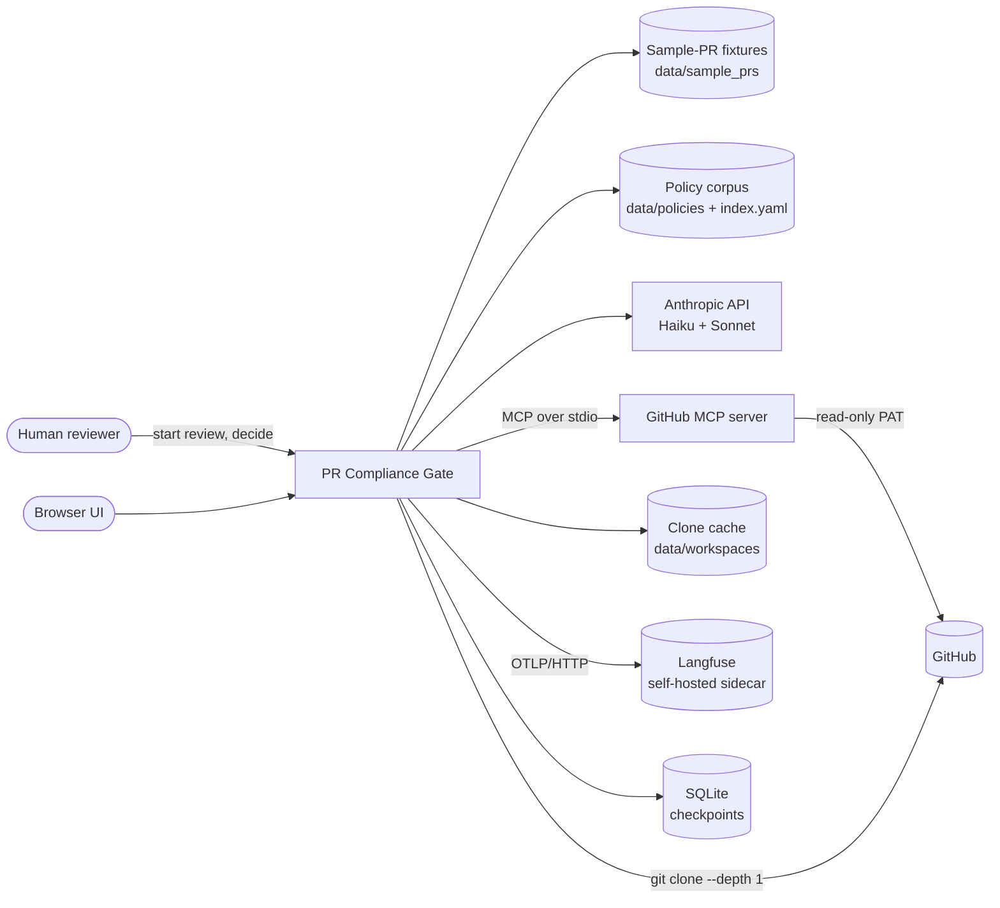
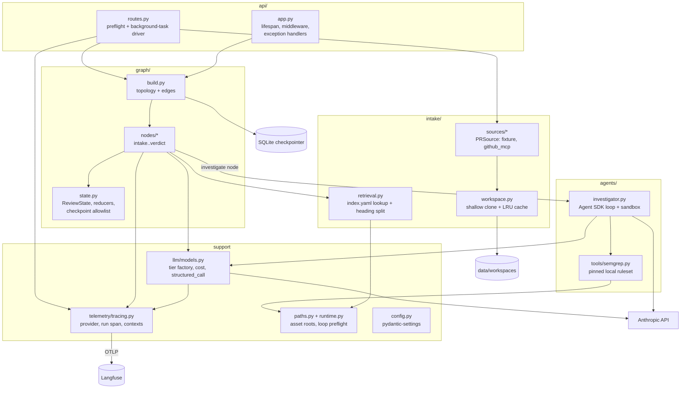
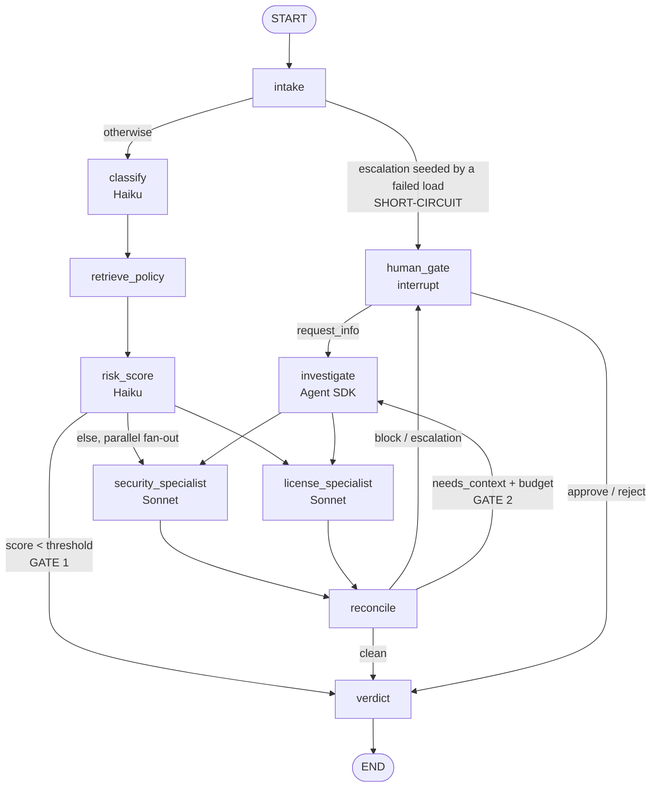
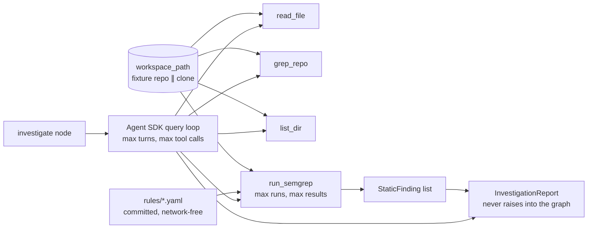
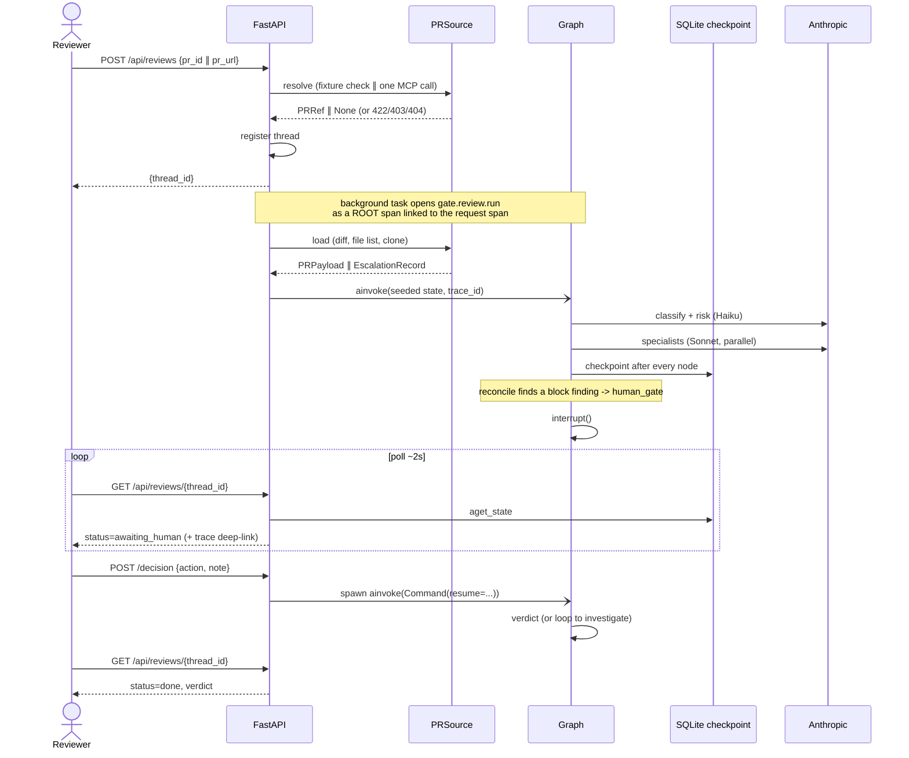
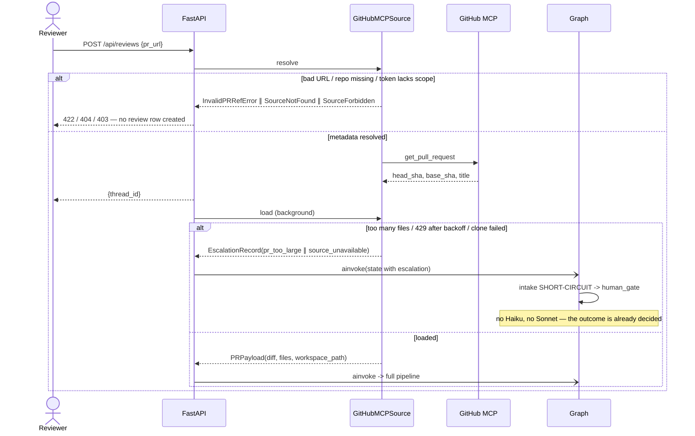
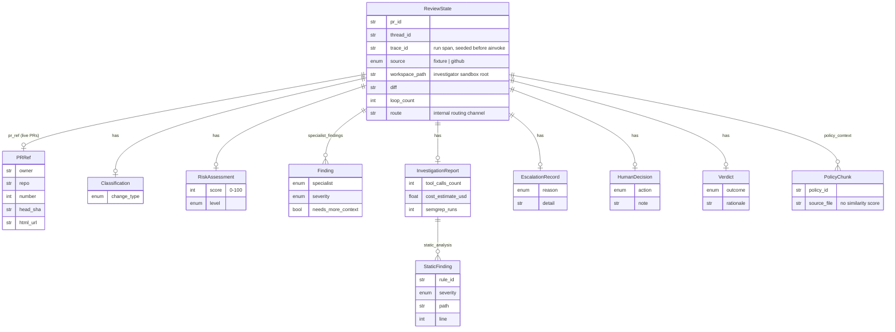
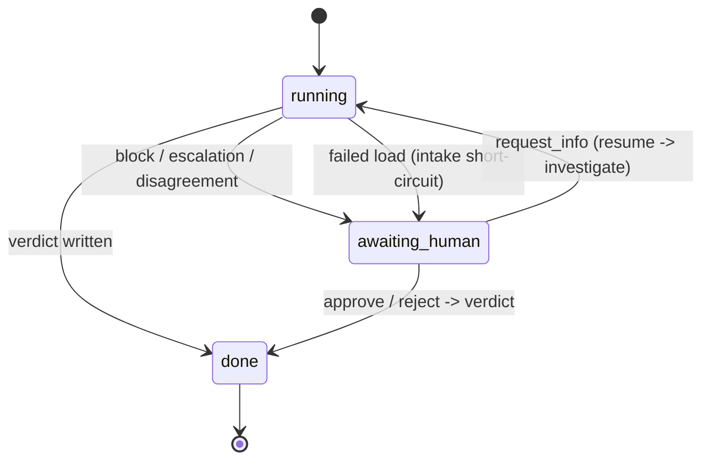

# Architecture — PR Compliance Gate

Living picture of the system as built. Diagrams carry the structure; the Key Decisions log at the
bottom carries the durable "why". Update a diagram when the system's shape changes, not per commit.

## System context

Who and what talks to the gate at its boundary. A PR arrives from a local fixture *or* from live
GitHub; every run is exported as a trace.

## Components

Internal pieces and how they connect. The graph is the application; the API is a thin driver.

## Graph topology

The LangGraph state machine — the heart of the system. `reconcile` writes `state.route`; the
conditional edge reads it. Two cost gates and the intake short-circuit are marked.

## Investigator sandbox

One graph node; the Agent SDK owns the inner loop. Four read-only tools over an injected
workspace root, under hard budgets. The harness owns every metric — the model authors only text.

## Review lifecycle (with human-in-the-loop)

One review end to end. `resolve` is the cheap preflight in the handler; `load` and the graph run
happen in a background task under a root span, and the UI polls. The human gate is a LangGraph
interrupt resumed by a later request.

## Live intake failure containment

Where a live-PR failure lands depends on which side of the request/background seam it happens on.
That split is the reason `PRSource` has two methods.

## Data model

`ReviewState` is the checkpointed root; every sub-model is a Pydantic v2 structured-output target.
Composition, not a relational schema (persistence is a serialized checkpoint blob). Every type here
is named in `CHECKPOINT_ALLOWLIST`.

## Review status state machine

The status the API derives from the checkpoint (`_derive_status`). `awaiting_human` -> `running`
happens on a `request_info` decision that loops back into investigation; both terminal paths reach
`done` via a `verdict`.

## Key Decisions

### 2026-07-23 — LangGraph state machine checkpointed to SQLite

**Status:** Accepted
**Context:** The pipeline needs resumable, inspectable multi-step review with parallel fan-out, a
loop, and a human pause. Options: hand-rolled async orchestration, a task queue (Celery), or a
graph framework with built-in checkpointing.
**Decision:** Use LangGraph with `AsyncSqliteSaver`. `ReviewState` is the single checkpointed
source of truth; each node returns a partial-state dict merged and persisted after every node.
**Consequences:** Human-in-the-loop is a native `interrupt`/`Command(resume=...)` that survives
process restarts. Checkpointed sub-values may deserialize as dicts or Pydantic instances, so
readers must handle both. Concurrent same-superstep writes require explicit channel reducers.

### 2026-07-23 — Two explicit cost gates

**Status:** Accepted
**Context:** Sonnet specialists and the Agent SDK investigator are the expensive steps. An
unconditional pipeline would spend Sonnet tokens on trivial changes.
**Decision:** Gate #1 (`_route_after_risk`): sub-threshold risk exits at `verdict(auto_approved)`
before any specialist runs. Gate #2 (`reconcile` rule 3): the investigator runs only when a
specialist set `needs_more_context` and loop budget (`GATE_MAX_CYCLES`) remains.
**Consequences:** Cost is bounded and legible; the demo arc is built to exercise both. The gates
are load-bearing — collapsing either changes the system's cost behavior and must be a recorded
decision.

### 2026-07-23 — reconcile is a pure-Python routing brain (no LLM)

**Status:** Accepted
**Context:** Routing after the specialists (investigate vs human vs verdict) must be deterministic,
testable, and cheap.
**Decision:** `reconcile` computes the route from accumulated findings + loop budget via a
first-match-wins rule ladder and writes `state.route`; the conditional edge only reads it. No LLM
call. `loop_count` is incremented solely by the `investigate` node so a checkpoint resume can't
double-count.
**Consequences:** Routing is unit-testable without API calls (`test_reconcile.py`) and free.
Adding a route means extending the ladder, not prompt-tuning.

### 2026-07-23 — Investigator as a nested Agent SDK loop inside one graph node

**Status:** Accepted; toolset extended by *2026-08-08 — Semgrep as the investigator's fourth tool*
**Context:** Deep investigation needs an autonomous multi-tool loop, but the graph should see a
single node with bounded cost and no failure leaking into orchestration.
**Decision:** The `investigate` node runs a Claude Agent SDK `query` loop with three read-only
sandboxed tools (`read_file`, `grep_repo`, `list_dir`) over the PR's `repo/` snapshot, under hard
turn/tool-call/byte budgets. It never raises into the graph — any error or budget exhaustion
returns an inconclusive `InvestigationReport`, landing failure on a human at the gate. The harness
owns all metrics; the model authors only narrative in a final structured-output turn.
**Consequences:** Investigator failure degrades gracefully instead of crashing a review. Sandbox
(`resolve_in_sandbox`) is pure/module-level and unit-tested independently of the SDK. The SDK is
young, so message/cost extraction is duck-typed to tolerate surface drift.

### 2026-07-23 — Local embeddings + Chroma for policy retrieval

**Status:** Superseded by *2026-08-08 — Deterministic policy lookup replaces vector retrieval*
**Context:** The policy corpus is tiny; paying API embedding cost per run is wasteful.
**Decision:** Embed policies locally with `sentence-transformers/all-MiniLM-L6-v2` into a Chroma
store via a one-time `python -m gate.intake.ingest`.
**Consequences:** No API spend for retrieval; ingest is a required setup step before real runs.

### 2026-07-23 — Session-scoped review registry + background-task API

**Status:** Accepted
**Context:** `GET /api/reviews` must list reviews, but the checkpointer has no "list all threads"
call; and polling only works if the POST returns before the run finishes.
**Decision:** Keep an in-memory `OrderedDict` (thread_id -> `Registration`) in `app.state.reviews`
to back the list view; per-review state is read live from the checkpoint. Each graph run and resume
is launched as a tracked background `asyncio` task, returning immediately.
**Consequences:** The list view is session-scoped (reviews created before a restart aren't listed,
though each stays reachable by `thread_id`). Background-task exceptions are logged, not surfaced.
A live review is listed with its source badge during the clone window, before its first checkpoint
exists. Acceptable for a single-user local demo. (Mirrors DECISION_LOG entry 5.)

### 2026-08-08 — Deterministic policy lookup replaces vector retrieval

**Status:** Accepted (supersedes *2026-07-23 — Local embeddings + Chroma for policy retrieval*)
**Context:** RAG earns its place when, after metadata narrowing, the candidate set still exceeds
what fits in context, or when disambiguation inside a category is genuinely semantic. Neither holds
at a three-document corpus keyed by a closed `change_type` enum. The embedding stack was four
dependencies and a required ingest step buying nothing.
**Decision:** `data/policies/index.yaml` maps each `change_type` to policy files, plus whole-token
keyword overrides against `touched_areas`. Files are split on `##` headings into `PolicyChunk`s
labelled with the heading's `policy_id`. `validate_policy_index()` runs in the lifespan and fails
the *process* on an unmapped enum member, a missing file, or an unlabelled heading — a runtime
fallback would be unreachable in a correct install, and unreachable branches get deleted here, not
pragma'd. Chroma, sentence-transformers and `intake/ingest.py` are gone.
**Consequences:** Setup drops from three steps to two and retrieval is reproducible. `PolicyChunk`
loses `distance` — the only *narrowing* change in v2, hence `GATE_STATE_VERSION = 2` and a
documented `checkpoints.db` delete rather than a migration. Specialists now see the *complete* set
of headings for the relevant files instead of a top-k sample, so a policy can no longer be missed
for ranking seventh. Revisit embeddings only at the threshold in `ITER_01_v2 §02`: when one
`change_type` maps to more policy text than fits alongside the diff. Raw policy count is not the
trigger.

### 2026-08-08 — OpenTelemetry spans exported to a self-hosted Langfuse

**Status:** Accepted
**Context:** The cost claims (low-risk PRs never touch Sonnet; the investigator stops at its
budget) were assertions with nothing behind them. Options: a collector + trace store + query UI
(three moving parts against a single-command local run), raw OTel (no LLM semantics — no tokens,
cost, or prompt capture), or the Langfuse SDK (vendor lock-in).
**Decision:** Write real OTel spans in application code and export them over OTLP/HTTP to a
Langfuse container started by a committed dev-time compose file. Langfuse is addressed purely as an
endpoint; its SDK is deliberately not a dependency. `GATE_OTEL_ENABLED=false` installs a no-op
provider so the app runs with no backend.
**Consequences:** Point the same exporter at Jaeger or Tempo and nothing changes. Three traps are
designed for rather than debugged: the run span is a *root* linked to the request span because the
run outlives the request; the parallel specialist fan-out needs an explicit `context=` because
contextvars do not follow into LangGraph branches; and the lifespan drains background tasks
*before* `provider.shutdown()`. `tracer()` reads this module's own provider, not the OTel global,
because `set_tracer_provider` is a process-wide once-guard that would silently refuse the kill
switch. Diffs and prompts land in span payloads — acceptable only because the backend is
self-hosted and the corpus is fixtures and public repos.

### 2026-08-08 — PRSource with two methods, and the intake short-circuit

**Status:** Accepted
**Context:** Live PRs must not leak into every node, and a single `load()` cannot express "a bad
URL is a 422 but a clone failure is an escalation" — it forces either a POST that blocks on a clone
or a typo'd URL creating a review row.
**Decision:** `PRSource` is a `Protocol` split at the request/background seam. `resolve` is cheap,
runs in the handler, and raises HTTP-mapped errors; `load` is slow, runs in the background task,
and fails by returning an `EscalationRecord`. MCP supplies the structured surface (metadata, file
list, diff); the repo *tree* is a shallow clone at `head_sha`, cached under `data/workspaces/` with
LRU eviction. The investigator's sandbox root becomes the injected `workspace_path`, never derived
from `pr_id`. A failed load seeds its escalation into the initial state and `intake` gains one
conditional edge to `human_gate`.
**Consequences:** The one graph-topology change in v2, and the only edge that exists purely to save
money — a diff-less review no longer asks Haiku to classify nothing. A failed review still runs
*through* the graph, so it stays checkpointed, resumable, traced, and reachable through the same
`/pending` and `/decision` endpoints; a second non-graph failure path would have cost a parallel
implementation of the whole lifecycle. Workspace directories are named by validated 40-hex SHA
only — branch names contain `/` and can contain `..`. The token is a read-only PAT: the gate never
comments, labels or merges.

### 2026-08-08 — Semgrep as the investigator's fourth tool

**Status:** Accepted (extends *2026-07-23 — Investigator as a nested Agent SDK loop*)
**Context:** `read_file` / `grep_repo` / `list_dir` are exploration; for a security and licensing
gate, findings only as good as grep are the weakest link.
**Decision:** Add `run_semgrep` as a tool *inside the existing loop*, not a new graph node — which
reinforces the claim that LangGraph sees one node and the SDK owns the inner loop. It runs a
committed `rules/` ruleset resolved through `paths.py` to an absolute path, never `--config auto`.
Results are shaped down to rule id, path, line, message and severity, and land in
`InvestigationReport.static_analysis`, which specialists receive on loop-back.
**Consequences:** `--config auto` fetches rules over the network at run time, which would break the
no-network sandbox and make results non-deterministic — so the local ruleset is load-bearing, and
`rules/` joins `data/` and `static/` in the wheel's `force-include` map. A *failed* run still
increments `semgrep_runs` and still spends a tool call; otherwise a broken scanner is free to retry
until the turn budget dies. `semgrep_runs`, not an empty list, is what separates "ran and found
nothing" from "never ran" — the UI keys its empty state off the counter. semgrep is an optional
extra because it is a large install and lags new interpreters; the harness degrades to
`semgrep unavailable: <reason>` without it.
