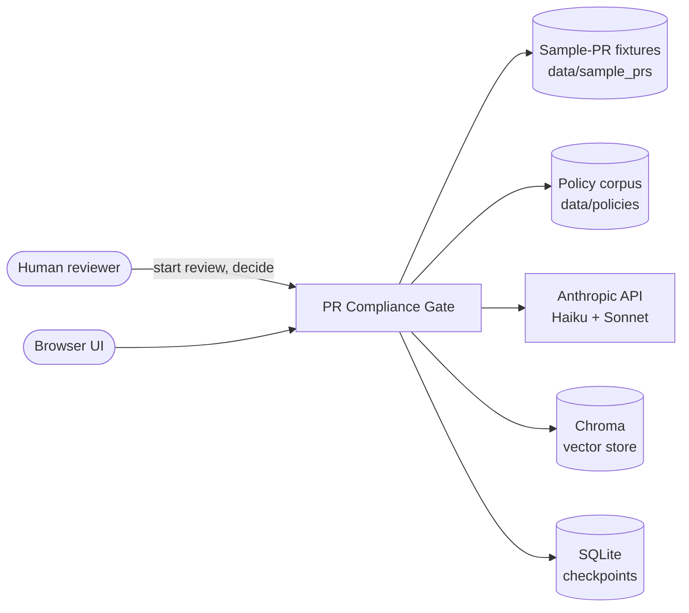
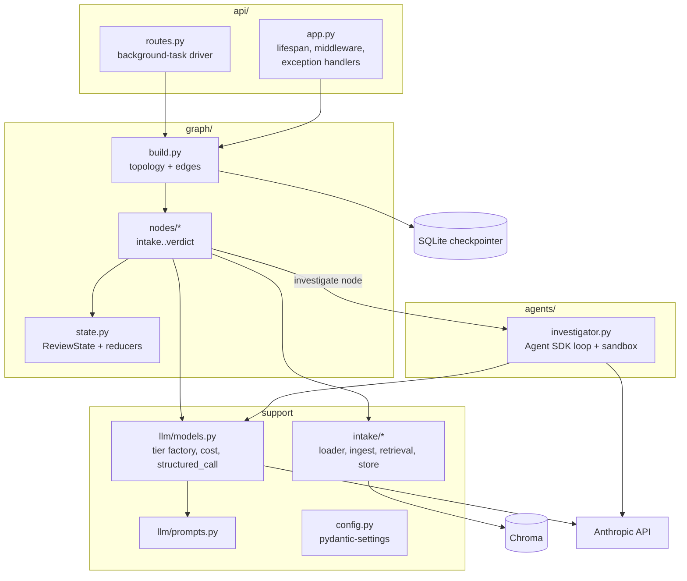
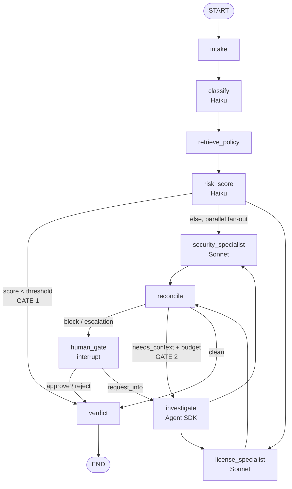
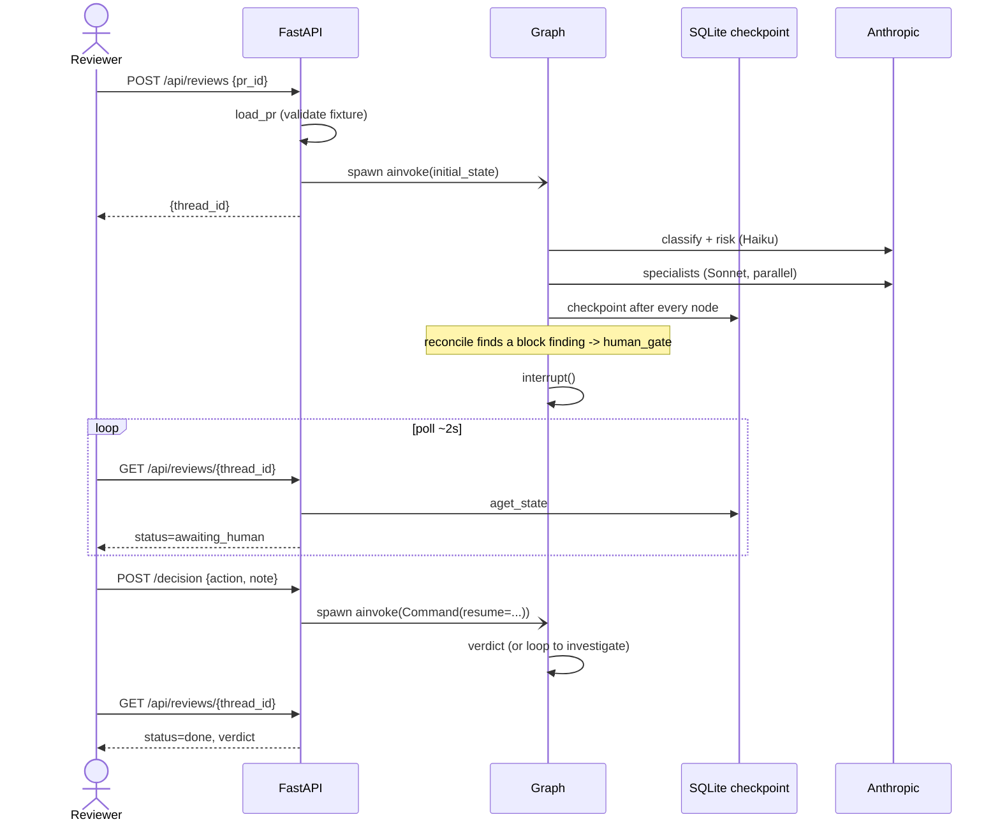
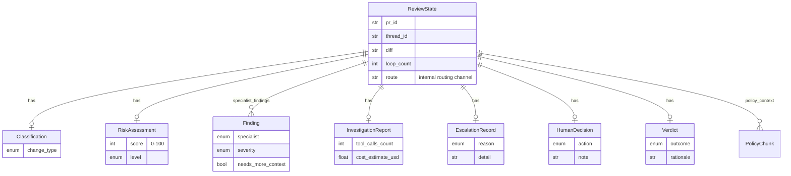
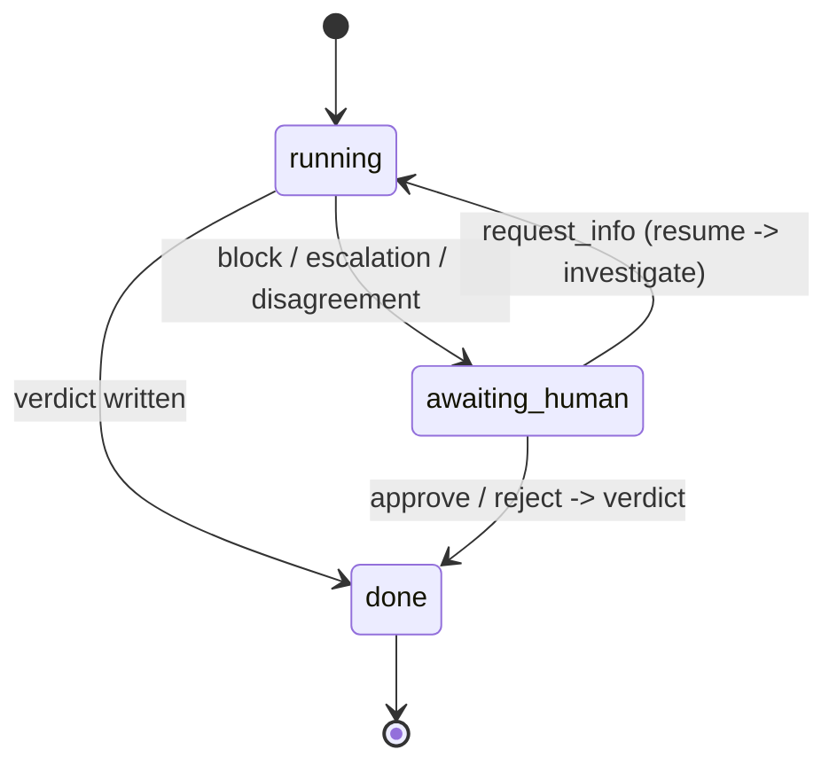

# Architecture — PR Compliance Gate

Living picture of the system as built. Diagrams carry the structure; the Key Decisions log at the
bottom carries the durable "why". Update a diagram when the system's shape changes, not per commit.

## System context

Who and what talks to the gate at its boundary.

## Components

Internal pieces and how they connect. The graph is the application; the API is a thin driver.

## Graph topology

The LangGraph state machine — the heart of the system. `reconcile` writes `state.route`; the
conditional edge reads it. Two cost gates marked.

## Review lifecycle (with human-in-the-loop)

One review end to end. The API spawns the graph run as a background task and the UI polls; the
human gate is a LangGraph interrupt resumed by a later request.

## Data model

`ReviewState` is the checkpointed root; every sub-model is a Pydantic v2 structured-output target.
Composition, not a relational schema (persistence is a serialized checkpoint blob).

## Review status state machine

The status the API derives from the checkpoint (`_derive_status`). `awaiting_human` -> `running`
happens on a `request_info` decision that loops back into investigation; both terminal paths reach
`done` via a `verdict`.

## Key Decisions

### 2026-07-23 — LangGraph state machine checkpointed to SQLite

**Status:** Accepted
**Context:** The pipeline needs resumable, inspectable multi-step review with parallel fan-out, a
loop, and a human pause. Options: hand-rolled async orchestration, a task queue (Celery), or a
graph framework with built-in checkpointing.
**Decision:** Use LangGraph with `AsyncSqliteSaver`. `ReviewState` is the single checkpointed
source of truth; each node returns a partial-state dict merged and persisted after every node.
**Consequences:** Human-in-the-loop is a native `interrupt`/`Command(resume=...)` that survives
process restarts. Checkpointed sub-values may deserialize as dicts or Pydantic instances, so
readers must handle both. Concurrent same-superstep writes require explicit channel reducers.

### 2026-07-23 — Two explicit cost gates

**Status:** Accepted
**Context:** Sonnet specialists and the Agent SDK investigator are the expensive steps. An
unconditional pipeline would spend Sonnet tokens on trivial changes.
**Decision:** Gate #1 (`_route_after_risk`): sub-threshold risk exits at `verdict(auto_approved)`
before any specialist runs. Gate #2 (`reconcile` rule 3): the investigator runs only when a
specialist set `needs_more_context` and loop budget (`GATE_MAX_CYCLES`) remains.
**Consequences:** Cost is bounded and legible; the demo arc is built to exercise both. The gates
are load-bearing — collapsing either changes the system's cost behavior and must be a recorded
decision.

### 2026-07-23 — reconcile is a pure-Python routing brain (no LLM)

**Status:** Accepted
**Context:** Routing after the specialists (investigate vs human vs verdict) must be deterministic,
testable, and cheap.
**Decision:** `reconcile` computes the route from accumulated findings + loop budget via a
first-match-wins rule ladder and writes `state.route`; the conditional edge only reads it. No LLM
call. `loop_count` is incremented solely by the `investigate` node so a checkpoint resume can't
double-count.
**Consequences:** Routing is unit-testable without API calls (`test_reconcile.py`) and free.
Adding a route means extending the ladder, not prompt-tuning.

### 2026-07-23 — Investigator as a nested Agent SDK loop inside one graph node

**Status:** Accepted
**Context:** Deep investigation needs an autonomous multi-tool loop, but the graph should see a
single node with bounded cost and no failure leaking into orchestration.
**Decision:** The `investigate` node runs a Claude Agent SDK `query` loop with three read-only
sandboxed tools (`read_file`, `grep_repo`, `list_dir`) over the PR's `repo/` snapshot, under hard
turn/tool-call/byte budgets. It never raises into the graph — any error or budget exhaustion
returns an inconclusive `InvestigationReport`, landing failure on a human at the gate. The harness
owns all metrics; the model authors only narrative in a final structured-output turn.
**Consequences:** Investigator failure degrades gracefully instead of crashing a review. Sandbox
(`resolve_in_sandbox`) is pure/module-level and unit-tested independently of the SDK. The SDK is
young, so message/cost extraction is duck-typed to tolerate surface drift.

### 2026-07-23 — Local embeddings + Chroma for policy retrieval

**Status:** Accepted
**Context:** The policy corpus is tiny; paying API embedding cost per run is wasteful.
**Decision:** Embed policies locally with `sentence-transformers/all-MiniLM-L6-v2` into a Chroma
store via a one-time `python -m gate.intake.ingest`.
**Consequences:** No API spend for retrieval; ingest is a required setup step before real runs.

### 2026-07-23 — Session-scoped review registry + background-task API

**Status:** Accepted
**Context:** `GET /api/reviews` must list reviews, but the checkpointer has no "list all threads"
call; and polling only works if the POST returns before the run finishes.
**Decision:** Keep an in-memory `OrderedDict` (thread_id -> pr_id) in `app.state.reviews` to back
the list view; per-review state is read live from the checkpoint. Each graph run and resume is
launched as a tracked background `asyncio` task, returning immediately.
**Consequences:** The list view is session-scoped (reviews created before a restart aren't listed,
though each stays reachable by `thread_id`). Background-task exceptions are logged, not surfaced.
Acceptable for a single-user local demo. (Mirrors DECISION_LOG entry 5.)
