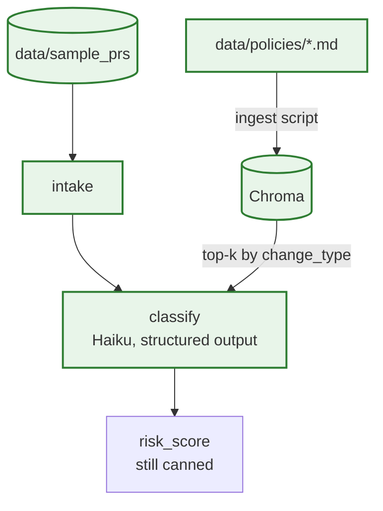

# ITER_01 — Intake, Policy Retrieval, Classifier

## §01 · Concept

> Unchanged — see SKELETON § 01

## §02 · Architecture

Everything downstream of `classify` remains canned (see SKELETON § 02). One data-model extension: **PolicyChunk** gains `distance: float` (retrieval score) — extends, does not contradict, the SKELETON definition.

## §03 · Tech Stack

New/pinned this iteration (rationale: first real LLM + retrieval code, so pin what the code depends on):

- `langchain-anthropic >= 0.3` — structured output against Anthropic models
- `langchain-chroma >= 0.2` + `chromadb >= 1.0` — local persistent vector store
- Embeddings: `sentence-transformers` via `langchain-huggingface` (local, free — avoids burning API spend on a demo corpus of ~3 documents)

> Everything else unchanged — see SKELETON § 03

## §04 · Backend

**Policy corpus (authored content, part of this iteration's work):** write the three real policy docs, ~1–2 pages each, with stable heading IDs the specialists will later cite (`SEC-01` "No new network egress without review", `LIC-02` "No copyleft licenses in runtime dependencies", `DATA-03` "No PII in logs", etc.).

**Ingestion:** `uv run python -m gate.intake.ingest` — chunks `data/policies/*.md` by heading (`MarkdownHeaderTextSplitter`), embeds, upserts into Chroma at `GATE_CHROMA_DIR`. Idempotent: collection is recreated on each run (corpus is tiny; no incremental sync).

**`intake/loader.py` (real):** reads `meta.json` + `diff.patch`, parses changed file paths from the patch headers into `files_changed[]`. Malformed fixture → `422` with the parse error (fail loud, not silently empty).

**`intake/retrieval.py` (real):** `retrieve(classification) -> list[PolicyChunk]` — top-k (k=6) query built from `change_type` + `touched_areas`, returned into `policy_context`.

**`nodes/classify.py` (real):** Haiku call via the shared model factory, `.with_structured_output(Classification)`. Input: diff truncated to a `GATE_MAX_DIFF_CHARS` budget (new env var; default 20 000) — head+tail slices with a `[... truncated N chars ...]` marker so oversized diffs can't blow the context window.

**Node ordering fix:** retrieval needs the classification, so the graph edge order is `intake → classify → retrieve_policy → risk_score`; `retrieve_policy` is a new thin node in `nodes/` wrapping `intake/retrieval.py`. (SKELETON's diagram showed retrieval feeding classify; this iteration corrects the sequence — the state fields are unchanged.)

**New env vars:** `GATE_MAX_DIFF_CHARS`, `GATE_EMBED_MODEL`.

**Tests:** fixture-loader unit tests; classifier test hits the real API once behind a `pytest.mark.llm` marker (excluded from default run) plus a mocked structured-output test in the default suite.

## §05 · Frontend

> Unchanged — see SKELETON § 05 (Classification panel now shows real data automatically via null-safe rendering)

## §06 · LLM / Prompts

- **`CLASSIFY_SYSTEM` (real):** instructs the model to classify the diff into exactly one `change_type`, list `touched_areas` as short noun phrases, and summarize in ≤2 sentences; explicitly told to output only the structured object.
- **Context strategy:** diff (truncated per §04) is the only context — policy chunks are *not* given to the classifier; they're retrieved after classification for downstream nodes. Keeps the cheap gate cheap.
- **Evaluation approach:** `tests/eval_classify.py` (marker `llm`) asserts the three sample PRs classify to their expected `change_type` recorded in each fixture's `meta.json` (`expected_classification` field, added this iteration).
