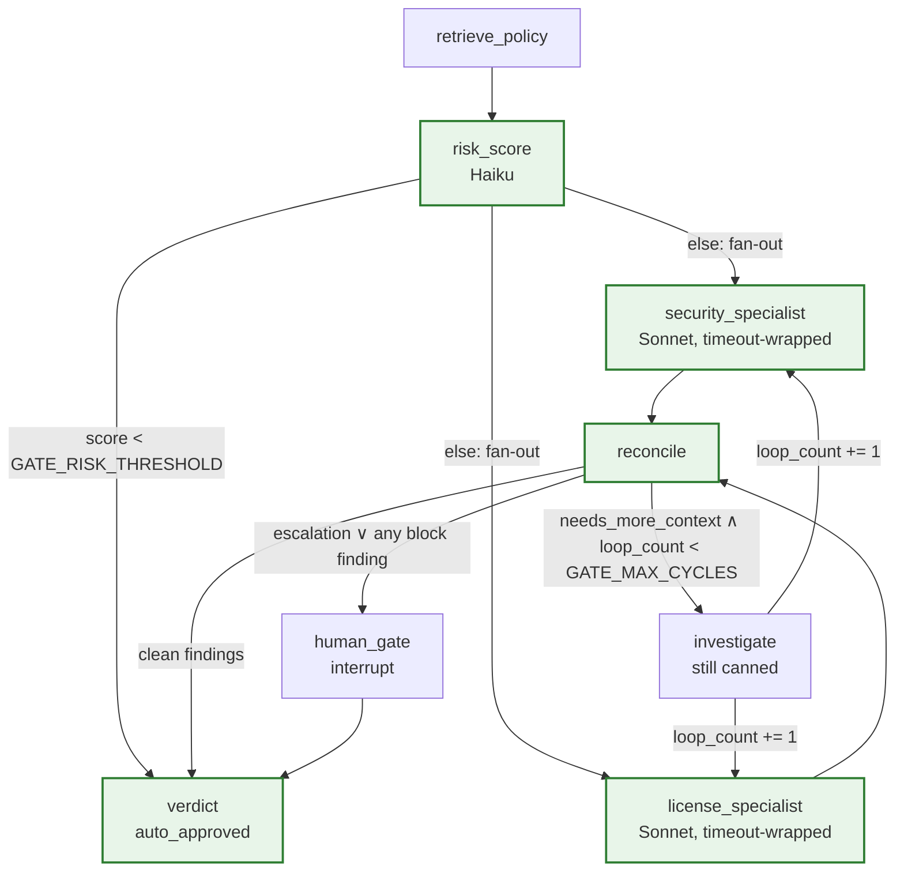

# ITER_02 — Orchestration Backbone and Failure Modes

## §01 · Concept

> Unchanged — see SKELETON § 01

## §02 · Architecture

**Cost gate #1 lands here:** low-risk changes never touch a Sonnet call — they exit at `verdict(auto_approved)` straight from the Haiku risk scorer. The `investigate` node stays canned (it returns "no additional context found", so any loop taken this iteration terminates on the next reconcile pass) — real in ITER_03.

Data-model extension: `RiskAssessment` gains `model_used: str`; `EscalationRecord.detail` now documented as human-readable, includes the disagreeing findings' `policy_id`s when `reason=disagreement`. Extends SKELETON § 02, contradicts nothing.

## §03 · Tech Stack

> Unchanged — see ITER_01 § 03 (no new dependencies; timeouts use stdlib `asyncio`)

## §04 · Backend

**`nodes/risk.py` (real):** Haiku, `.with_structured_output(RiskAssessment)`, input = classification + policy_context summaries + truncated diff. `level` is derived server-side from `score` against `GATE_RISK_THRESHOLD` (default 40) and a fixed high bound (75) — the model proposes a score; thresholds live in config, not the prompt, so tuning never means re-prompting.

**Fan-out/fan-in:** `risk_score` conditionally routes to **both** specialists via LangGraph parallel branches; `specialist_findings` is an `Annotated[list, operator.add]` reducer so parallel writes merge instead of clobbering (the classic parallel-branch trap — called out here so it's designed, not discovered).

**`nodes/specialists.py` (real):** each specialist gets diff + its policy slice (`policy_id` prefix `SEC-*` / `LIC-*` from `policy_context`), outputs `list[Finding]`. Each call is wrapped in `asyncio.wait_for(..., timeout=GATE_SPECIALIST_TIMEOUT_S)`; on `TimeoutError` the node writes `EscalationRecord(reason="timeout", detail=...)` and returns no findings — the graph proceeds; it never hangs.

**`nodes/reconcile.py` (real) — the routing brain, pure Python, no LLM.** Decision order (first match wins):
1. `escalation` present → route `human_gate`
2. any `Finding.severity == "block"` → route `human_gate`
3. any `needs_more_context` and `loop_count < GATE_MAX_CYCLES` → route `investigate`
4. any `needs_more_context` and loop budget exhausted → write `EscalationRecord(reason="max_cycles")` → `human_gate`
5. **disagreement check:** findings from different specialists on the same `policy_id` whose severities span `info/warn` vs `block` → `EscalationRecord(reason="disagreement")` → `human_gate` (ordered after rule 2 by design: a lone `block` already escalates; this catches contested calls)
6. otherwise → `verdict`

**`nodes/verdict.py` (real):** pure Python. `auto_approved` when arriving from the low-risk edge; `approved`/`rejected` mapped from `human_decision.action` when arriving from the gate; `rationale` assembled from findings + decision note. (Resume wiring for `request_info` is specified in ITER_04 with the decision endpoint.)

**Loop-count integrity:** `loop_count` is incremented in exactly one place — the `investigate` node — never in reconcile, so a re-entrant checkpoint resume can't double-count.

**Tests:** reconcile unit tests cover all six routes with synthetic findings (no LLM); a timeout test monkeypatches the specialist call with `asyncio.sleep` beyond the limit and asserts the escalation path.

## §05 · Frontend

> Unchanged — see SKELETON § 05 (Risk, Findings, Escalation panels now populate; decision buttons remain disabled per the SKELETON convention until ITER_04)

## §06 · LLM / Prompts

- **`RISK_SYSTEM`:** score the change 0–100 for policy risk given classification + policy excerpts; must cite which excerpts drove the score in `reasons[]`.
- **`SPECIALIST_SYSTEM` (parameterized by specialty):** review the diff strictly against the provided policy chunks; every Finding must reference a real `policy_id` from context; set `needs_more_context=true` only when a specific unanswered question about the codebase blocks judgment — and state that question in `description` (ITER_03's investigator consumes it).
- **Context strategy:** specialists receive only their policy slice, never the whole corpus — keeps prompts small and makes citations checkable.
- **Evaluation:** extend `meta.json` with `expected_route` (`auto_approve | human_gate | clean_verdict`); `tests/eval_routes.py` (marker `llm`) runs the three fixtures end-to-end (investigator still canned) and asserts the route taken.
