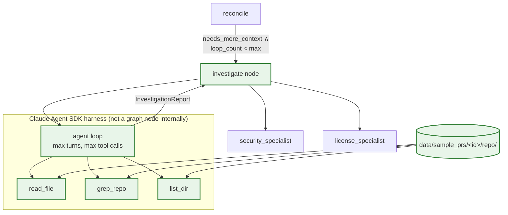

# ITER_03 — Investigator Sub-Agent

## §01 · Concept

> Unchanged — see SKELETON § 01

## §02 · Architecture

The architectural point this iteration demonstrates: the investigator is a **harness-driven loop, not a graph node internally** — LangGraph sees one node with one entry and one exit; the Agent SDK owns the inner tool loop. **Cost gate #2:** the harness only ever runs when reconcile's rule 3 fires (ITER_02 § 04), and inside it, hard budgets bound spend.

Data-model note: no new fields — `InvestigationReport` from SKELETON § 02 is now actually populated (`tool_calls_count`, `cost_estimate_usd` were designed for this).

## §03 · Tech Stack

New this iteration:

- `claude-agent-sdk >= 0.1` — the investigator harness (pin the minor version in `pyproject.toml` at install time; the SDK is young and its option surface moves)

> Everything else unchanged — see ITER_01 § 03

## §04 · Backend

**`agents/investigator.py` (real):**

- **Tools exposed to the agent (all sandboxed):** `read_file(path)`, `grep_repo(pattern)`, `list_dir(path)` — every path is resolved and required to be inside `data/sample_prs/<pr_id>/repo/` (`Path.resolve()` + `is_relative_to()` check); anything else returns a tool error, not an exception. No write tools, no shell, no network.
- **Budgets (env-driven):** `GATE_INVESTIGATOR_MAX_TURNS` (default 8), `GATE_INVESTIGATOR_MAX_TOOL_CALLS` (default 15), per-file read cap `GATE_INVESTIGATOR_MAX_FILE_CHARS` (default 15 000, head+tail truncation as in ITER_01) — the context-overflow strategy is these caps; no summarization pass needed at this scale.
- **Input:** the open questions — every `Finding` with `needs_more_context=true` (question text in its `description`, per ITER_02 § 06) plus `files_changed[]` as starting leads.
- **Output:** `InvestigationReport` via a final structured-output turn. `cost_estimate_usd` computed from the SDK's reported token usage × a static per-model price table in `llm/models.py` (documented as an estimate, not billing truth).
- **Failure containment:** budget exhaustion or SDK error does **not** raise into the graph — the harness returns a report with `summary="investigation inconclusive: <reason>"`. Reconcile then re-evaluates; with no new context the loop budget drains and rule 4 escalates to the human gate. Failure lands on a human, never in a stack trace.

**`nodes/investigate.py` (updated):** replaces the canned return with a call into the harness; still the sole place `loop_count` increments (ITER_02 invariant preserved). Specialist re-runs after investigation receive `investigation.summary` appended to their context.

**Fixture upgrade:** `003_auth_change/repo/` gets enough real files (a small auth module, a logging config, a dependency manifest) that the investigator has genuine leads to chase — the demo depends on this being non-trivial.

**Tests:** path-sandbox unit tests (escape attempts → tool error); budget test with a mocked SDK loop asserting the harness stops at the cap; one `llm`-marked end-to-end run of fixture 003 asserting `investigation` is populated and `tool_calls_count <= cap`.

## §05 · Frontend

> Unchanged — see SKELETON § 05 (Investigation panel now populates, including tool-call count and cost estimate)

## §06 · LLM / Prompts

- **Investigator system prompt:** "You are investigating specific open questions about a code change. Answer only those questions; use the fewest tool calls that settle them; stop when they're answered or genuinely unanswerable from the repo." Budgets are stated in the prompt *and* enforced by the harness — the prompt shapes behavior; the harness guarantees it.
- **Context strategy:** questions + `files_changed[]` up front; tool results accumulate in the SDK loop, bounded by the per-file and tool-call caps above.
- **Evaluation:** fixture 003's `meta.json` gains `expected_investigation_hits[]` (substrings that should appear in `files_examined`); the `llm`-marked test asserts at least one hit — behavioral smoke, not a benchmark.
