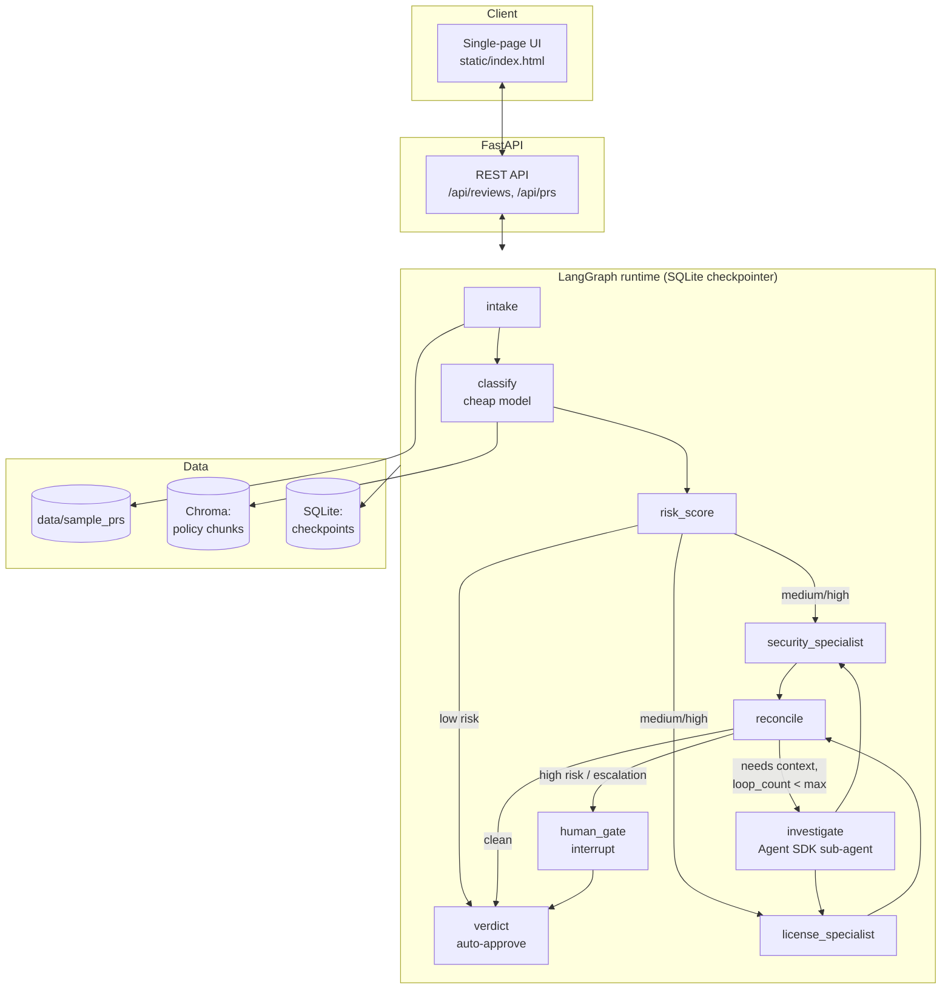

# SKELETON — PR Compliance Gate

## §01 · Concept

An agentic pipeline that reviews pull requests against organizational policy (security, licensing, data-handling) before merge. A cheap classifier and risk scorer gate the pipeline; medium/high-risk changes fan out to specialist agents, which can request deeper autonomous investigation; high-risk or contested reviews stop at a human approval gate. **Core flow:** submit a sample PR → watch it move through classify → risk → specialists → (investigate) → human gate → verdict, resumable from a checkpoint at every step. Audience: portfolio reviewers evaluating production-grade agent orchestration (failure modes, cost gating, HITL) — not a hosted product.

## §02 · Architecture



**Data model** (Pydantic models in `state.py`; all live inside the graph state, checkpointed by LangGraph — no separate ORM):

- **ReviewState** — root graph state: `pr_id`, `thread_id`, `diff`, `files_changed[]`, `policy_context[]`, `classification`, `risk`, `specialist_findings[]`, `investigation`, `loop_count` (int, default 0), `escalation`, `human_decision`, `verdict`
- **PolicyChunk** — `text`, `policy_id`, `source_file`
- **Classification** — `change_type` (enum: `code | dependency | config | docs | data_handling`), `summary`, `touched_areas[]`
- **RiskAssessment** — `score` (0–100), `level` (enum: `low | medium | high`), `reasons[]`
- **Finding** — `specialist` (enum: `security | license`), `severity` (enum: `info | warn | block`), `policy_id`, `description`, `confidence` (0–1), `needs_more_context` (bool)
- **InvestigationReport** — `summary`, `findings[]`, `files_examined[]`, `tool_calls_count`, `cost_estimate_usd`
- **EscalationRecord** — `reason` (enum: `timeout | disagreement | max_cycles`), `detail`
- **HumanDecision** — `action` (enum: `approve | reject | request_info`), `note`, `decided_at`
- **Verdict** — `outcome` (enum: `approved | rejected | auto_approved`), `rationale`

**API surface** (full MVP target stated here; implementations stubbed until their iteration):

| Method | Path | Description |
|---|---|---|
| GET | `/` | Serves `static/index.html` |
| GET | `/api/prs` | List sample PR fixtures (`pr_id`, `title`, `files_changed_count`) |
| POST | `/api/reviews` | Body `{pr_id}` → starts a graph run, returns `{thread_id}` |
| GET | `/api/reviews` | List reviews: `{thread_id, pr_id, status, risk_level}` (no pagination — bounded local data, deferred) |
| GET | `/api/reviews/{thread_id}` | Full `ReviewState` snapshot from the checkpointer |
| GET | `/api/reviews/{thread_id}/pending` | Pending interrupt payload for the human gate, or `204` |
| POST | `/api/reviews/{thread_id}/decision` | Body `{action, note}` → resumes graph from checkpoint |

**Cross-origin / auth:** UI is served by the same FastAPI app — same origin, **no CORS middleware needed** (documented so it isn't added reflexively). No auth: single-user local demo; auth is explicitly deferred (see terminator's out-of-scope list).

## §03 · Tech Stack

- **Language/runtime:** Python 3.12, managed with `uv`
- **Orchestration:** `langgraph` + `langgraph-checkpoint-sqlite` (checkpointed resume)
- **Linear intake leg:** `langchain`, `langchain-anthropic`, `langchain-chroma`
- **Investigator harness:** `claude-agent-sdk` (added in ITER_03; listed here for the target picture)
- **API:** `fastapi` + `uvicorn`
- **Vector store:** Chroma, local persistent directory
- **Frontend:** one static HTML file, vanilla JS, no build tooling
- **Storage:** SQLite (`checkpoints.db`) for graph state; Chroma dir for policy embeddings. No migrations needed — LangGraph manages its own checkpoint schema.

No version pins at skeleton stage; pins land in the iteration that adds each dependency.

## §04 · Backend

```
pr-compliance-gate/
├── pyproject.toml
├── .env.example
├── README.md
├── data/
│   ├── sample_prs/          # 3 fixtures: 001_docs_typo/, 002_new_dependency/, 003_auth_change/
│   │   └── <id>/            #   each: meta.json, diff.patch, repo/ (minimal file snapshot)
│   └── policies/            # security.md, licensing.md, data-handling.md (stub headings only)
├── src/gate/
│   ├── config.py            # pydantic-settings; env-driven
│   ├── graph/
│   │   ├── state.py         # all Pydantic models above
│   │   ├── build.py         # graph wiring, edges, checkpointer
│   │   └── nodes/
│   │       ├── intake.py  classify.py  risk.py
│   │       ├── specialists.py  investigate.py
│   │       ├── reconcile.py  verdict.py
│   ├── intake/
│   │   ├── loader.py        # sample PR fixture loader
│   │   └── retrieval.py     # policy chunk retrieval (stub)
│   ├── llm/
│   │   ├── models.py        # model-tier factory (classifier/specialist/investigator)
│   │   └── prompts.py
│   ├── agents/
│   │   └── investigator.py  # Agent SDK harness (stub)
│   └── api/
│       ├── app.py           # FastAPI app, serves static/
│       └── routes.py
├── static/index.html
└── tests/
    └── test_graph_smoke.py  # canned run reaches verdict
```

**Skeleton behavior:** every node returns **canned output** (fixed Classification, fixed medium risk, one fixed Finding each, canned InvestigationReport). The graph is fully wired with real conditional edges and the SQLite checkpointer, and `human_gate` performs a real LangGraph `interrupt()` — so start → interrupt → resume works end-to-end on day one, just with fake content.

Representative stub (route group pattern):

```python
# api/routes.py
@router.post("/api/reviews")
async def start_review(body: StartReview) -> dict:
    thread_id = str(uuid4())  # UUIDs, never MAX+1 counters
    config = {"configurable": {"thread_id": thread_id}}
    await graph.ainvoke(initial_state(body.pr_id), config)  # runs until interrupt or END
    return {"thread_id": thread_id}
```

**Run locally:** `uv run uvicorn gate.api.app:app --reload` (single command; README documents it).

**Env vars** (`.env.example`, names only): `ANTHROPIC_API_KEY`, `GATE_DB_PATH`, `GATE_CHROMA_DIR`, `GATE_MODEL_CLASSIFIER`, `GATE_MODEL_SPECIALIST`, `GATE_MODEL_INVESTIGATOR`, `GATE_RISK_THRESHOLD`, `GATE_MAX_CYCLES`, `GATE_SPECIALIST_TIMEOUT_S`.

**Gotcha addressed — cached config:** `config.py` uses `pydantic-settings` behind a `get_settings()` accessor with `@lru_cache`; `tests/conftest.py` clears the cache (`get_settings.cache_clear()`) in a session fixture **before** any test imports trigger a load, so test env vars are honored.

## §05 · Frontend

Single page, no router — views toggled by JS state:

- **Review list** (default view): table of reviews with status badge (`running / awaiting_human / done`) and risk level; "Start review" dropdown fed by `GET /api/prs`. Empty state: "No reviews yet — start one above."
- **Review detail**: panels for Classification, Risk, Findings, Investigation, Escalation, Verdict — each renders "—" when its state field is null (placeholder strategy: null-safe rendering, no mock data layer).
- **Decision panel** inside detail view: Approve / Reject / Request more info buttons + note field.

**UI-before-backend convention (stated once, applies family-wide):** controls whose backend lands in a later iteration render **disabled with a tooltip note** ("enabled in a later iteration"). In the skeleton, the decision panel's buttons are visible but disabled; ITER_04 enables them.

Component tree (vanilla JS modules in one file): `App` → `ReviewList`, `ReviewDetail` → `StatePanels`, `DecisionPanel`. Data via `fetch()` against same-origin `/api`; loading = inline spinner text, errors = red banner with the response message.

**Run locally:** same command as backend — FastAPI serves `static/`.

## §06 · LLM / Prompts

- **Purpose:** classification, risk scoring, specialist policy review, autonomous investigation.
- **Models (Anthropic API):** classifier + risk scorer → `claude-haiku-4-5` (cheap gate); specialists → `claude-sonnet-4-6`; investigator → `claude-sonnet-4-6` via Claude Agent SDK. All read from env, never hardcoded.
- **Skeleton prompts:** placeholder strings in `llm/prompts.py` (e.g. `CLASSIFY_SYSTEM = "You classify PR diffs. (stub)"`). No LLM call is made in the skeleton — nodes return canned objects.
- **I/O shape:** every LLM node targets structured output matching the §02 Pydantic models (LangChain `.with_structured_output()` for graph nodes).
- **Role constraint noted now:** Anthropic API takes the system prompt as a top-level parameter, not a `system` role message — the shared model factory in `llm/models.py` owns this so no node builds raw message arrays.
