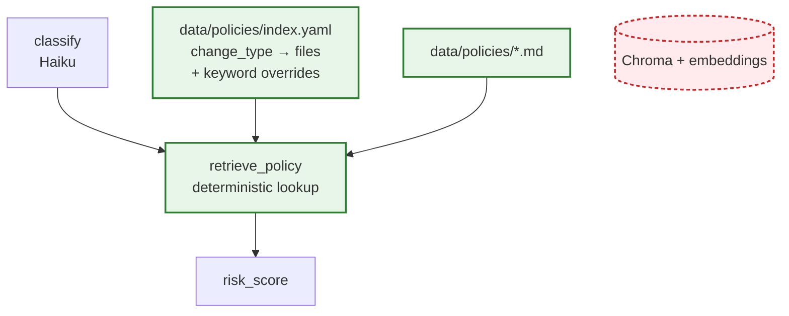

# ITER_01_v2 — Deterministic Policy Lookup

## §01 · Concept

> Unchanged — see SKELETON § 01

## §02 · Architecture



**Data-model change — the one deliberate narrowing in this family.** `PolicyChunk.distance: float` (added in ITER_01 § 02) is **removed**; there is no similarity score because there is no similarity search. **No field is added.** SKELETON § 02 already gives `PolicyChunk` a `policy_id`, and the heading parse populates *that* — a separate `heading_id` would be the same value under a second name, leaving specialists two candidate fields to cite and the citation contract ambiguous. `text` and `source_file` are retained unchanged. So: one field removed, none added, and the removal is flagged deliberately rather than dropped silently — everything else in the data model only extends.

**Allowlist consequence (ITER_05 § 04).** `state.py` now carries a `CHECKPOINT_ALLOWLIST` and every
checkpointer is wrapped with `use_state_allowlist(saver)`. A *shape* change to an already-listed model
needs no allowlist edit — `PolicyChunk` stays listed under the same name. The rule for the rest of this
family: **every new persisted entity must be added to `CHECKPOINT_ALLOWLIST` in the same iteration that
introduces it**, or checkpoint reads return bare dicts where models are expected. Stated once here and
applied in ITER_03_v2 (`PRRef`) and ITER_04_v2 (`StaticFinding`).

Rationale for the removal: RAG earns its place when, *after* metadata narrowing, the candidate set still exceeds what fits in context, or disambiguation within a category is genuinely semantic rather than categorical. Neither holds at a three-document corpus where `Classification.change_type` is already a closed enum. Embedding search here is unpaid-for machinery.

**Scaling threshold (documented decision, not a TODO):** revisit embedding-based retrieval when category narrowing stops yielding a small, context-fitting candidate set — i.e. when a single `change_type` maps to more policy text than fits comfortably alongside the diff, or when policies within one category overlap enough that only semantic similarity separates them. Raw policy count is not the trigger; 2 000 policies cleanly partitioned by category are still a lookup problem.

**No API surface change.** `policy_context: list[PolicyChunk]` on `ReviewState` is unchanged in name and position.

## §03 · Tech Stack

**Removed** (these existed only for the vector store):

- `langchain-chroma`, `chromadb`
- `sentence-transformers`, `langchain-huggingface`

**Added:** `pyyaml` (parse the policy index). `MarkdownHeaderTextSplitter` from `langchain-text-splitters` is retained — the heading split is still how policy files become citable chunks.

Net: four dependencies out, one in. `langchain` / `langchain-anthropic` stay for the classify/risk/specialist calls.

> Everything else unchanged — see ITER_01 § 03

## §04 · Backend

**`data/policies/index.yaml` (new, authored this iteration):**

```yaml
by_change_type:
  code:          [security.md, licensing.md]
  dependency:    [licensing.md, security.md]
  config:        [security.md, data-handling.md]
  data_handling: [data-handling.md, security.md]
  docs:          []
keyword_overrides:      # whole-token, case-folded match against Classification.touched_areas
  auth:     [security.md]
  logging:  [data-handling.md]
  network:  [security.md]
  telemetry: [data-handling.md]
```

Mapping lives in config, not code, so adding a policy file is a data edit. **Every member of the `change_type` enum must have an entry** — including `docs`, whose entry is deliberately empty rather than absent. That is enforced at startup (below), not by a runtime fallback: `change_type` is a closed enum the classifier's structured output already validates, so a missing key is a config error, not a condition to survive at review time. A runtime "unknown `change_type` → empty list + WARN" branch was the obvious alternative and is worse — it would be unreachable in a correctly-configured install, and unreachable branches are precisely what this family deletes rather than pragmas (see the coverage note below).

**`intake/retrieval.py` (rewritten):** `retrieve(classification) -> list[PolicyChunk]`

1. Resolve file set = `by_change_type[change_type]` ∪ every `keyword_overrides[k]` where `k` matches any `touched_areas` entry. **Matching is whole-token, case-folded, not substring** — `touched_areas` entries are short noun phrases (ITER_01 § 06), so `auth` must match "auth module" and "auth" but not "author metadata". Substring matching would be quieter to write and would pull `security.md` into a docs change about authorship. Deduplicate, preserve declaration order.
2. Read each file, split with `MarkdownHeaderTextSplitter` on `##`.
3. Parse `policy_id` from each heading's leading token (`## SEC-01 — No new network egress without review` → `SEC-01`). A heading without a parseable ID is a **fail-loud** `PolicyIndexError` at startup, not a silently unlabelled chunk — specialists cite `policy_id` and an unlabelled chunk breaks that contract.
4. Return `list[PolicyChunk]` in file-then-document order.

**Validation at startup, not first request:** a `validate_policy_index()` call in the FastAPI lifespan asserts every `change_type` enum member has an entry in `by_change_type`, every file named in `index.yaml` exists, and every heading yields a `policy_id`. A missing policy file or an unmapped enum member fails the process, not a review mid-run.

**Deleted:** `gate/intake/ingest.py` and its `uv run python -m gate.intake.ingest` step (README setup drops from three steps to two).

**Env vars removed:** `GATE_CHROMA_DIR`, `GATE_EMBED_MODEL`, and `POLICY_COLLECTION` (the Chroma
collection name, made explicit in ITER_05 § 04 — it dies with the store). **Added:** `GATE_POLICY_INDEX`
(default `data/policies/index.yaml`) and `GATE_STATE_VERSION` (default `2` — see the checkpoint-compatibility
note below; listed here so the env surface is complete in one place).

**Asset resolution, not CWD (ITER_05 § 03/§ 04).** `index.yaml` is a runtime asset, so it resolves through
`paths.py` — bundled copy at `gate/_bundled/data/policies/` first, repo root as fallback — never a
CWD-relative open. It is already inside the `data/` tree that hatchling `force-include`s into the wheel,
so no packaging map edit is needed; `GATE_POLICY_INDEX` overrides the resolved default rather than
replacing the resolution.

**`intake/store.py` dies with the store.** *Corrected 2026-08-09. This paragraph originally read
"`intake/store.py` is unaffected — it is the session-scoped thread registry, not the vector store,
naming coincidence only." That was wrong about the shipped code, and following it literally would
have left a module importing `langchain_chroma` after its only dependency was removed. See
DECISION_LOG entry 17.* `store.py` **is** the Chroma accessor, so it is deleted here alongside
`ingest.py`. The session-scoped thread registry backing `GET /api/reviews` (ITER_05 § 04) is
`app.state.reviews`, an `OrderedDict` created in the lifespan; nothing in this iteration touches
it. ITER_03_v2 § 04 extends *that* with a `Registration` model.

**Checkpoint compatibility — stated, not discovered.** LangGraph serializes `ReviewState` into `checkpoints.db`; removing `PolicyChunk.distance` makes pre-v2 checkpoints undeserializable on resume. There is **no migration** — this is local single-user demo data. Instead: `config.py` gains `GATE_STATE_VERSION` (bumped to `2`), the lifespan logs a fatal-but-clear message if the DB's recorded version differs, and the README instructs deleting `checkpoints.db`. Deliberate choice, documented so a reviewer sees the decision rather than a crash.

The allowlist does not change this. It governs *which* types msgpack will reconstruct, not whether an old
payload still matches the current field set — a v1 checkpoint carrying `distance` is still a v1 checkpoint.
`GATE_STATE_VERSION` remains the gate; the allowlist is the separate ITER_05 fix that keeps reconstruction
from degrading to bare dicts.

**Tests:** `tests/unit/test_retrieval.py` (no LLM, no network; layout per ITER_05 § 04) — index resolution for each `change_type`, `docs` resolving to an empty set without error, keyword-override union, whole-token matching (`auth` hits "auth module", misses "author metadata"), dedup/order stability, unmapped enum member → startup failure, missing file → startup failure, unparseable heading → `PolicyIndexError`. The ITER_01 mocked-classifier test is unaffected. `tests/system/eval_classify.py` is unaffected (the classifier never received policy context — ITER_01 § 06) and is now actually collected, since `python_files` includes `eval_*.py` (ITER_05 § 04).

**Coverage gate — family-wide constraint, stated once.** `fail_under = 100` enforces 100% statement *and*
branch coverage of `src/gate` (ITER_05 § 04). Every branch this family adds — the three startup-validation
failures here, the tracing kill switch in ITER_02_v2, each escalation path and the intake short-circuit in
ITER_03_v2, each semgrep failure mode in ITER_04_v2 — needs a unit test or the default suite goes red.
`llm`- and `network`-marked
tests are excluded from the measurement, so they cannot be used to cover a branch. Where v1 dealt with an
unreachable line by deleting it (retrieval's empty-query fallback), this family does the same: unreachable
code gets removed, not pragma'd — which is why the runtime `change_type` fallback above is a startup
assertion instead.

## §05 · Frontend

> Unchanged — see SKELETON § 05 (the Classification and Findings panels render identical shapes; only the retrieval mechanism behind `policy_context` changed)

## §06 · LLM / Prompts

- **No prompt text changes.** `RISK_SYSTEM` and `SPECIALIST_SYSTEM` (ITER_02 § 06) are unmodified.
- **Context strategy:** specialists still receive only their policy slice, selected by `policy_id` prefix from `policy_context` — the ITER_02 § 06 rule holds, with the shipped split from ITER_05 § 04: security gets `SEC-*` **and** `DATA-*`, license gets `LIC-*`. That is load-bearing here in a way it was not under top-k: `index.yaml` routes `config` and `data_handling` changes to `data-handling.md`, so if `DATA-*` chunks had no owning specialist the retrieval improvement would deliver a larger slice that nobody reads. What changed is that the slice is now the *complete* set of headings for the relevant files rather than a top-k sample, which makes citation coverage strictly better: a specialist can no longer miss a policy because it ranked seventh.
- **Evaluation:** `tests/system/eval_routes.py` (marker `llm`, ITER_02 § 06) is the regression check — expected routes for the three fixtures must be unchanged by the retrieval swap. If a route flips, retrieval got worse, and the test says so.
