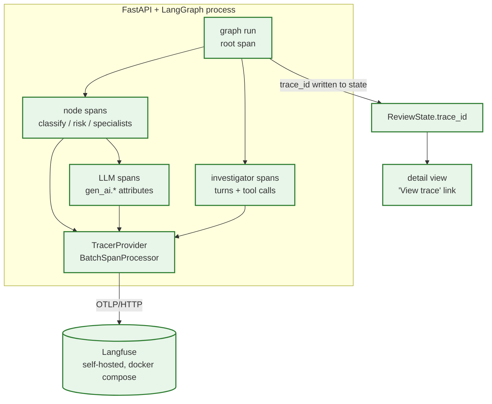

# ITER_02_v2 — OpenTelemetry Tracing

## §01 · Concept

> Unchanged — see SKELETON § 01

## §02 · Architecture

**Instrumentation, not infrastructure.** OTel spans are written directly in application code (real semantic conventions, real span hierarchy) and exported over OTLP to a self-hosted Langfuse container. Standing up a collector + trace store + query UI was considered and rejected: it is horizontal infra that adds three moving parts to a project whose scope constraint is a single-command local run, and raw OTel has no LLM semantics (tokens, cost, prompt/completion capture) — that schema work is exactly what Langfuse already solved. Exporting OTLP keeps the swap-out cheap: point the same exporter at Jaeger or Tempo and the instrumentation is unchanged.

**Deliberately placed before live intake (ITER_03_v2) and semgrep (ITER_04_v2).** Instrumentation is cross-cutting; adding it first means the two subsystems that follow are traced as they are built rather than retrofitted, and the first external network dependency lands with latency and failure visibility already in place.

**Data model:** `ReviewState` gains `trace_id: str | None` (default `None`) — the run span's trace ID, captured in the background task when that span opens and **seeded into the initial state before `ainvoke`** (§ 04), so the UI can deep-link. Seeded rather than written by the first node: `@traced_node` is applied uniformly and gains nothing from one node carrying a special responsibility, and a seeded value is already present in the very first checkpoint — including for a review that short-circuits at intake (ITER_03_v2 § 04), which is exactly the failure a reviewer most wants a trace link for. It is a `str`, so `CHECKPOINT_ALLOWLIST` (ITER_01_v2 § 02) is untouched — this iteration adds no new persisted entity, and the field being additive-with-default means `GATE_STATE_VERSION` stays at `2`. `InvestigationReport.cost_estimate_usd` (SKELETON § 02) is now also emitted as a span attribute; no field changes.

**No routing or node changes; one response-shape change.** `trace_id` rides along free because `GET /api/reviews/{thread_id}` returns the `ReviewState` snapshot (SKELETON § 02), but `GATE_LANGFUSE_UI_BASE` does not — it is server config, not review state, and § 05 needs it to build the deep-link. So that response becomes `{...ReviewState, langfuse_ui_base}` rather than a bare snapshot. Small, but it is the first place the detail response stops being exactly `ReviewState`, and stating it beats a reader discovering it in the JS. No new routes, no request-body change, no node added or removed.

## §03 · Tech Stack

New this iteration:

- `opentelemetry-sdk` and `opentelemetry-api` — span creation and the provider
- `opentelemetry-exporter-otlp-proto-http` — OTLP over HTTP (not gRPC: one fewer transport dependency, and Langfuse's ingestion is HTTP)
- `opentelemetry-instrumentation-fastapi` — request spans for the API surface. **Not** the parent of a graph run: `POST /api/reviews` returns as soon as the background task is spawned (ITER_05 § 04), so the request span closes while the run is still going. The run is a root span linked to the request span — see § 04.

**Not added:** the Langfuse Python SDK. Langfuse is an OTLP-compatible backend here, addressed purely as an endpoint — that is what keeps the instrumentation vendor-neutral.

**Langfuse itself** runs as a **dev-time sidecar** via a committed `docker-compose.langfuse.yml` (Langfuse + Postgres + ClickHouse per its published compose file). This is not a reversal of the "no hosted/containerized deployment" constraint — the *application* still runs with `uv run uvicorn`; the compose file starts an observability backend the developer already has locally. Pin the Langfuse image tag rather than tracking `latest`, and pin the OTLP ingestion path against Langfuse's current docs at install time (the endpoint path has moved across major versions).

> Everything else unchanged — see ITER_01_v2 § 03

## §04 · Backend

**`gate/telemetry/tracing.py` (new):**

- `init_tracing(app)` — builds the `TracerProvider` with `service.name = GATE_OTEL_SERVICE_NAME`, an `OTLPSpanExporter` pointed at `OTEL_EXPORTER_OTLP_ENDPOINT` with `OTEL_EXPORTER_OTLP_HEADERS` carrying Langfuse basic auth, and a `BatchSpanProcessor`. Called from the FastAPI lifespan.
- `AlwaysOnSampler` — no sampling. This is a demo with tens of runs; dropping traces to save volume buys nothing and makes the demo non-reproducible.
- **Kill switch:** `GATE_OTEL_ENABLED=false` installs a no-op provider. The app must run with the Langfuse container down — a portfolio reviewer cloning the repo should not need Docker to see the gate work.

**Gotcha — spans lost on shutdown.** `BatchSpanProcessor` buffers; a process that exits without flushing drops the tail of every trace, which shows up as reviews that "end" mid-graph in the UI. Fix: the FastAPI lifespan's teardown calls `provider.shutdown()` (which force-flushes) inside a `finally`, in the ordering fixed below, and the `llm`-marked eval tests call it explicitly before asserting on trace content.

**Gotcha — the graph run outlives its HTTP request.** The v1 plan assumed the handler awaited the run; the
shipped handler spawns a tracked background task and returns `{thread_id}` immediately (ITER_05 § 04).
Parenting node spans under the request span would therefore attach a multi-minute run to a span that ended
in milliseconds — and in a `BatchSpanProcessor` the parent may already have been exported. Fix: `gate.review.run`
is started **as a root span inside the background task**, carrying a span **link** to the request span whose
context is captured at handler time. The request trace shows "this call kicked off run X"; the run trace is
self-contained and starts at intake, which is what the UI deep-links. `ReviewState.trace_id` is the run
span's trace ID, never the request's.

**Gotcha — flush ordering on shutdown.** The lifespan teardown must cancel/await the tracked background tasks
**before** `provider.shutdown()`. Reversed, a run still in flight writes to a shut-down provider and its tail
spans vanish — the same symptom as the buffering gotcha above, from a different cause.

**Gotcha — orphaned spans across the parallel fan-out.** LangGraph runs `security_specialist` and `license_specialist` as parallel branches (ITER_02 § 04). OTel context is stored in a `contextvars` context that does **not** automatically follow into branches scheduled on separate tasks — instrument naively and both specialist spans attach to the wrong parent or become trace roots. Fix: the run span's context is captured **where the run span is opened — in the background task, before `ainvoke`** — and stored on a run-scoped object; the node decorator attaches spans with an explicit `context=` argument rather than relying on ambient context. Capturing it inside the `intake` node instead is the tempting shortcut and is wrong: `intake` is itself a child of the run span, so every subsequent node would parent to `intake` rather than to the run. Called out here so it is designed, not debugged.

**`@traced_node` decorator (in `gate/graph/nodes/__init__.py`):** wraps every node with a span named `gate.node.<name>` carrying `pr_id`, `thread_id`, `loop_count`, and — on exit — the node's routing outcome. Applied to every node in `nodes/` uniformly so no node is silently untraced; the decorator is the enforcement point, not a per-node opt-in.

**LLM spans** are emitted inside `gate/llm/models.py` (the shared factory — already the single choke point for every model call per SKELETON § 06), so no node builds its own LLM span. Attributes follow the OTel GenAI semantic conventions (`gen_ai.system`, `gen_ai.request.model`, `gen_ai.usage.input_tokens`, `gen_ai.usage.output_tokens`) plus Langfuse's expected input/output attributes so prompts and completions render rather than appearing as bare timing bars. Two attributes exist because of ITER_05 § 06 and are not optional: `gate.llm.effort` (the tier's reasoning effort, absent on `haiku` tiers, which reject the parameter) and `gate.llm.structured_output_method` (`json_schema` on effort-carrying tiers, `function_calling` otherwise). That pairing is the exact thing that silently broke specialists in v1; a span that records it makes the next occurrence a filter query rather than a debugging session. Thinking tokens get their own `gate.llm.thinking_tokens` attribute rather than being folded into `gen_ai.usage.output_tokens`, which stays exactly as the API reports it — the effort setting makes thinking a real cost line, and burying it inside a conventional attribute would make the two unreconcilable against a bill.

**Log correlation.** The structlog + correlation-id middleware (ITER_05 § 04) binds `trace_id` and `span_id`
into the log context, so a Langfuse trace and a stdout line for the same review are joinable. This is the
cheap half of observability and it would be strange to add tracing without it.

**Investigator spans** (`gate/agents/investigator.py`): one span per agent turn, one child span per tool call carrying `tool.name` and the sandboxed path/pattern. This is what makes cost gate #2 (ITER_03 § 02) *demonstrable* rather than asserted — the trace shows the harness stopping at its budget.

**Cost and guardrail attributes on the root span:** `gate.risk.level`, `gate.route.taken`, `gate.loop_count.final`, `gate.escalation.reason`, `gate.cost.investigator_usd`, `gate.specialists.timed_out`. These are the whole point: the v1 README *claims* low-risk PRs never touch Sonnet; a trace filtered on `gate.risk.level=low` with zero Sonnet spans *proves* it.

**Privacy note:** diffs and prompts land in span payloads. Acceptable precisely because Langfuse is self-hosted and the corpus is fixtures/public repos; `ANTHROPIC_API_KEY` and the GitHub token are never span attributes — the model factory reads them from settings and never echoes them.

**New env vars:** `GATE_OTEL_ENABLED`, `GATE_OTEL_SERVICE_NAME`, `OTEL_EXPORTER_OTLP_ENDPOINT`, `OTEL_EXPORTER_OTLP_HEADERS`, `GATE_LANGFUSE_UI_BASE` (used only to build the UI's trace deep-link).

**Gotcha — two of those escape the `GATE_` prefix.** `Settings` is `pydantic-settings` with a `GATE_` prefix (SKELETON § 04), so a field named `otel_exporter_otlp_endpoint` would read `GATE_OTEL_EXPORTER_OTLP_ENDPOINT` and never see the variable the OTel SDK itself reads. The two `OTEL_*` names are the SDK's own convention and are kept unprefixed deliberately — anyone who has configured OTel before will set them without reading this repo's docs — which means declaring them with an explicit per-field alias. Getting this wrong is silent: the exporter falls back to `localhost:4318`, which is usually right in local dev and wrong everywhere else, so it surfaces as traces vanishing rather than as an error.

**Tests:** `tests/unit/test_tracing.py` uses OTel's `InMemorySpanExporter` — asserts one span per node on a canned run, asserts the two specialist spans share the run span as parent (the fan-out gotcha, now regression-covered), asserts the run span is a root carrying a link to the request span rather than its child (the background-task gotcha), asserts a disabled-tracing run emits zero spans and still reaches a verdict. The kill-switch path is a branch, so `fail_under = 100` (ITER_01_v2 § 04) requires that last assertion regardless — it is not optional politeness.

## §05 · Frontend

- **Review detail gains a "View trace" link**, rendered only when `trace_id` is non-null, pointing at `${GATE_LANGFUSE_UI_BASE}/traces/{trace_id}`. The base URL is served to the UI as part of the `GET /api/reviews/{thread_id}` payload rather than hardcoded in JS.
- When tracing is disabled the link is **omitted entirely** — not disabled-with-tooltip. The SKELETON § 05 disabled convention covers controls whose backend arrives in a later iteration; this is a feature that is off by configuration, and a permanently dead button is worse than no button.
- No other view changes; existing null-safe rendering and the red-banner error pattern hold.

> Otherwise unchanged — see ITER_04 § 05

## §06 · LLM / Prompts

- **No prompt changes.** Tracing observes the existing calls.
- **Context strategy:** unchanged — see ITER_01_v2 § 06.
- **Evaluation:** `tests/system/eval_demo.py` (ITER_04 § 06, relocated per ITER_05 § 04) gains a trace assertion — after a full fixture run, the in-memory exporter must contain at least one span per node reached and a root span carrying `gate.route.taken`. Cheap, and it stops instrumentation from silently rotting as later iterations add nodes.
