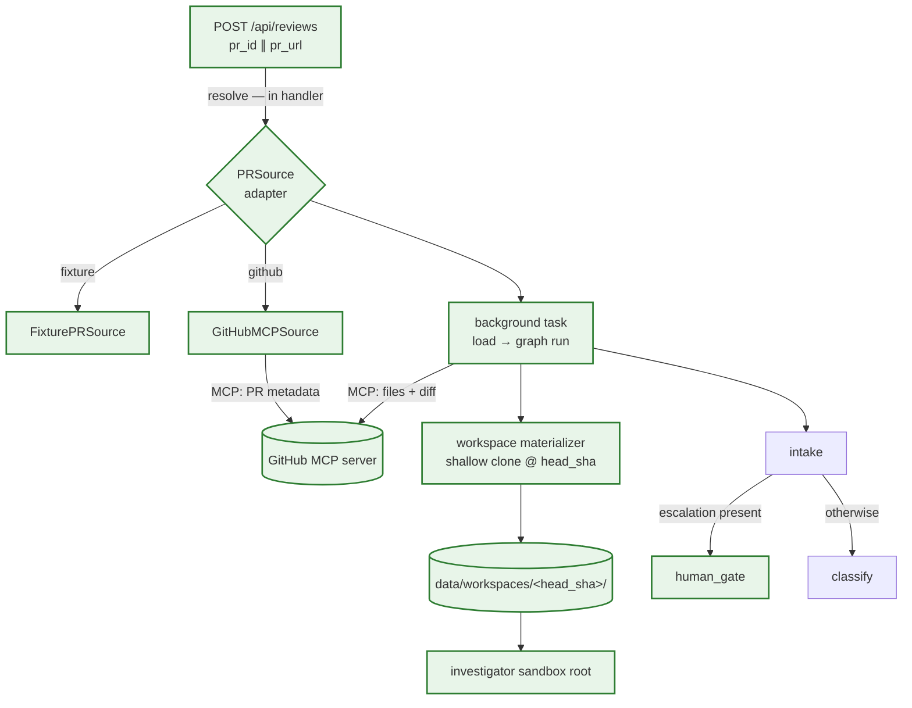

# ITER_03_v2 — Live GitHub MCP Intake

## §01 · Concept

> Unchanged — see SKELETON § 01 (the gate reviews *real* pull requests now; the flow it runs them through is the same)

## §02 · Architecture

**The adapter is the design decision.** `PRSource` is a `Protocol` with two methods, split exactly where the request/background boundary falls (§ 04): `resolve(ref_input) -> PRRef | None` — cheap, runs in the handler, raises the HTTP-mapped errors — and `load(ref) -> PRPayload` — slow, runs in the background task, fails by escalation. **Two methods rather than one is the load-bearing choice.** A single `load()` cannot express "a bad URL is a `422` but a clone failure is an escalation": it forces either the whole live intake into the handler (a POST that blocks on a clone, which the polling UI is built to avoid) or every failure into an escalation (a typo'd URL creating a review row). Two implementations satisfy both methods; `FixturePRSource.resolve` is the directory-name validation and returns `None`, since fixtures have no `PRRef`. Everything downstream of `intake` is unchanged and unaware of where the PR came from, which is what keeps the live path from leaking into every node in the graph. The protocol is also the seam that absorbs the one genuine unknown in this version: the GitHub MCP server's exact tool names and response shapes. If they differ from expectation, one class changes.

**MCP for structured data, git for bulk file materialization.** The MCP server supplies PR metadata, the changed-file list and the diff — the structured API surface. The repo *tree* is materialized with a shallow clone at `head_sha`, because pulling hundreds of files one-at-a-time through MCP tool calls to satisfy the investigator's `read_file`/`grep_repo` would be absurd, and semgrep (ITER_04_v2) needs files on disk regardless. Stating the split explicitly is better than pretending MCP does everything.

**Data model — extensions only:**

- New entity **`PRRef`** — `owner`, `repo`, `number`, `head_sha`, `base_sha`, `html_url`, `title`
- New entity **`PRPayload`** (adapter return, not persisted) — `ref: PRRef | None`, `diff`, `files_changed[]`, `workspace_path`
- `ReviewState` gains `source: Literal["fixture","github"]`, `pr_ref: PRRef | None`, `workspace_path: str | None` (null when `load` failed before materializing — see the intake short-circuit in § 04; a non-optional `str` would force an empty-string sentinel that the sandbox check would then have to special-case)
- `ReviewState.pr_id` is retained and, for live PRs, set to `{owner}/{repo}#{number}` — existing list/detail rendering keeps working with no null-handling
- `PRRef` is persisted inside `ReviewState`, so it is **added to `CHECKPOINT_ALLOWLIST`** (ITER_01_v2 § 02). `PRPayload` is an adapter return value that never reaches a checkpoint and stays out — listing it would imply a persistence contract that does not exist.
- **All three new `ReviewState` fields carry defaults** — `source="fixture"`, `pr_ref=None`, `workspace_path=None` — so a checkpoint written earlier in the v2 family still deserializes. `GATE_STATE_VERSION` (ITER_01_v2 § 04) therefore stays at `2`: it exists for the one *narrowing* in this family, and purely additive fields with defaults are not a break. Bumping it here would force a `checkpoints.db` delete for no reason, which trains a reader to ignore the version check.

**`pr_id` validation, reconciled with ITER_05 § 04.** v1 hardened `load_pr` to reject any `pr_id` that is not
a plain directory name, because `pr_id` was joined onto the fixture directory *and* became the investigator's
sandbox root — a `..` segment relocated the sandbox itself. The live `pr_id` here contains `/` and `#` and
would fail that check, which is correct and not a conflict: **the check belongs to `FixturePRSource`, not to
`ReviewState`.** This iteration makes that explicit — the validation moves into the fixture adapter unchanged,
and the coupling it was defending against is severed, because the sandbox root is now `workspace_path`,
injected by the adapter, never derived from `pr_id`. For the GitHub source `pr_id` is a display and lookup
key only and is never used as a path component; the `head_sha` regex is what guards the live path.

**API change (extension, not a break):** `POST /api/reviews` body becomes `{pr_id?: str, pr_url?: str}` with **exactly one** required; both or neither → `422 {"error": "provide exactly one of pr_id, pr_url"}`. `GET /api/prs` (fixtures) is unchanged. `GET /api/reviews` list items gain `source`.

## §03 · Tech Stack

New this iteration:

- `mcp` (official Python SDK) — client for the GitHub MCP server, launched as a stdio subprocess from config. Pin the minor version; the SDK surface still moves.
- No git library. Shallow clone is a fixed-argv `asyncio.create_subprocess_exec("git", ...)` call — one dependency avoided, and it keeps the "no shell" invariant from ITER_03 § 04 intact.

> Everything else unchanged — see ITER_02_v2 § 03

## §04 · Backend

**`gate/intake/sources/` (new package):** `base.py` (the `PRSource` protocol + `PRPayload`), `fixture.py` (wraps the existing ITER_01 loader — no behaviour change), `github_mcp.py`.

**`github_mcp.py` — the live path**, split across the protocol's two methods:

`resolve(pr_url) -> PRRef` — runs in the request handler:

1. Parse `pr_url` into a `PRRef` with a strict regex against `https://github.com/{owner}/{repo}/pull/{n}`. Anything else → `422` with the expected form. No guessing at shorthand.
2. Open an MCP session (stdio) against the GitHub MCP server; fetch PR metadata → `head_sha`, `base_sha`, `title`. This is the one round trip that proves the repo exists and the token can see it, which is why it is worth doing before a thread exists.

`load(ref) -> PRPayload` — runs in the background task:

3. Fetch the changed-file list. **Gotcha — the files endpoint is paginated** (30 per page by default). Iterate until a short page returns; a single unpaginated call silently reviews a subset of a large PR, and a compliance gate that misses files is worse than one that refuses. A `GATE_GH_MAX_FILES` cap (default 300) is enforced explicitly: exceeding it *returns* an `EscalationRecord(reason="pr_too_large")` rather than a diff. `load` cannot route — it runs before the graph — so the background task seeds it into the initial state and the intake short-circuit (below) does the routing.
4. Fetch the diff, truncate to the existing `GATE_MAX_DIFF_CHARS` budget (ITER_01 § 04) using the same head+tail marker — no new truncation strategy.
5. Materialize the workspace (below), return `PRPayload`.

The MCP session is opened in both methods rather than held across them: a session pinned open across the handler/background boundary would outlive the request that created it and need its own lifecycle. Two short sessions cost one extra subprocess spawn and remove that problem entirely.

**`EscalationRecord.reason`** gains two members: `pr_too_large`, `source_unavailable`. Extends the SKELETON § 02 enum; the existing three are untouched. The `coalesce_escalation` reducer (ITER_05 § 04) is first-write-wins, which is the behaviour these two need: an escalation written at intake survives to the human gate and cannot be overwritten by a later specialist timeout, so the reviewer sees the *original* cause. No reducer change.

**The one graph-topology change: an intake short-circuit.** Both new reasons are raised by `load`, *before* the graph has a diff — and `reconcile` rule 1 ("escalation present → human_gate", ITER_02 § 04) only fires after classify, risk and the specialists have run. Routing a diff-less review down that path means asking Haiku to classify nothing and Sonnet to review nothing: spend and noise on a review whose outcome is already decided. So `intake` gains a conditional edge — **escalation present → `human_gate`, otherwise → `classify`** — and the human sees the packet with `escalation.reason` set and every other panel null, which the UI's null-safe rendering (SKELETON § 05) already handles.

**The graph still runs.** A failed `load` seeds `escalation` into the initial state and the background task invokes the graph exactly as it would for a healthy PR — it does not skip to a terminal state out-of-band. That is what keeps the failed review checkpointed, resumable, traced under the same run span, and reachable through the same `/pending` and `/decision` endpoints as every other review. A short-circuit inside the graph costs one edge; a second, non-graph failure path would cost a parallel implementation of the entire review lifecycle.

This is the only edge added in the v2 family, and it is worth being explicit that it *is* a topology change rather than filing it under "reconcile already routes escalations": reconcile does, but not early enough to be free. Rule 1 is unmodified and still catches escalations raised mid-graph.

**Workspace materialization (`gate/intake/workspace.py`):**

- `git clone --depth 1 --filter=blob:none` of the repo, then fetch and check out `head_sha`. Cached at `data/workspaces/{head_sha}/`.
- **Same event-loop trap as the Agent SDK (ITER_05 § 04).** `asyncio.create_subprocess_exec` needs a proactor-capable loop; `--reload`/`--workers` force a `SelectorEventLoop` and the call raises a bare `NotImplementedError`. The loop preflight v1 added to `run_investigation` is generalized into one shared check that the clone and (ITER_04_v2) semgrep both call, returning a named failure instead of an empty message. `--reload` stays absent from every documented command.
- Workspaces live outside the packaged asset tree. `GATE_WORKSPACE_DIR` resolves via `paths.py` (ITER_05 § 04) to a writable location and is never written inside `gate/_bundled/` — an installed wheel's package directory may be read-only, and a clone cache does not belong in it.
- **Directory name is the `head_sha`, never a branch or repo name.** Branch names legitimately contain `/` and can contain `..`; using them as path components is a traversal bug waiting to happen. A 40-char hex SHA validated by regex cannot escape.
- LRU eviction against `GATE_WORKSPACE_MAX_GB` (default 5) on a `mtime` sweep at startup and after each materialization. Unbounded clone caches are how a demo repo grows to 40 GB.
- The **investigator sandbox root becomes `workspace_path`** rather than the hardcoded `data/sample_prs/<pr_id>/repo/`. The `Path.resolve()` + `is_relative_to()` check from ITER_03 § 04 is unchanged in mechanism — only the root is now injected instead of derived. Fixtures pass their existing `repo/` path, so the fixture demo is untouched.

**Where the live path runs — preflight vs. background task.** The shipped handler does not await the graph;
it validates, registers the thread and spawns a tracked background task (ITER_05 § 04). Live intake is
therefore split at that seam, deliberately:

- **Synchronous preflight, inside the handler (`resolve`):** URL parse → `PRRef`, then the single MCP metadata call that
  resolves `head_sha`/`base_sha`/`title`. Bounded (one round trip, no clone), and it is what makes a bad URL,
  a missing repo or a token without scope a `422`/`404`/`403` *before* a thread exists. A user who typoed a
  URL gets an error, not a review row that fails a minute later.
- **Background task, after the thread is registered (`load`, then the graph run):** file-list pagination, diff fetch, workspace clone, and
  the graph run. These are the slow, retryable parts; their failures are escalations, not HTTP errors,
  because a thread already exists to carry them.

The in-memory registry (`app.state.reviews`, ITER_05 § 04 — *corrected 2026-08-09 from
`intake/store.py`; see ITER_01_v2 § 04*) records `source` and — for live PRs — `pr_ref` at
registration time, so `GET /api/reviews` lists a live review with its badge before its first checkpoint
exists. The v1 first-review race fix (a known thread reads as `running` until its first checkpoint) covers
the longer live window unchanged; nothing new is needed for it.

**Failure containment — the same principle as the investigator harness (ITER_03 § 04): failure lands on a human, never in a stack trace.**

- Auth failure / repo not found / private repo without scope → `403` or `404` from the preflight, *before* a thread is created. No half-started reviews.
- **Rate limiting (429):** bounded exponential backoff, three attempts, jittered. The thread already exists by then (it was registered before the background task started), so on final failure `load` returns `EscalationRecord(reason="source_unavailable")`, intake short-circuits, and the review sits at the human gate showing why — rather than a 500 the user never sees, since nobody is waiting on the response.
- Clone failure → same escalation path.
- **Tracing follows the same split (ITER_02_v2 § 04).** `resolve` failures land in the *request* span — they never reach a run, so there is no run trace to put them in. `load` failures, including the retry sequence, are children of the run span, and the run span carries `gate.pr.source` (`fixture` / `github`) so live and fixture runs are separable with a filter. A `source_unavailable` review therefore still has a complete, linked trace; a 404'd URL has only a request span, which is the honest picture.

**Token scope, stated:** a read-only PAT with `contents:read` + `pull_requests:read`, in `GATE_GITHUB_TOKEN`. No write scopes — the gate never comments, labels or merges (see the terminator's out-of-scope list). This is a security posture, not an omission.

**No auth on the app itself** — still a single-user local demo, still deliberately deferred (SKELETON § 02). Worth re-stating here because live intake is the point where a reader may assume otherwise: the app has no users, so there is no ownership dimension on `/api/reviews/{thread_id}` and the ITER_04 § 04 note on 403-vs-404 continues to not apply.

**New env vars:** `GATE_GITHUB_TOKEN`, `GATE_GH_MCP_COMMAND`, `GATE_GH_MAX_FILES`, `GATE_WORKSPACE_DIR`, `GATE_WORKSPACE_MAX_GB`.

**Tests — mocked client, explicitly not replay.** `tests/fixtures/github/` holds JSON payloads captured once by hand from a real public PR. `MockGitHubMCPSource` returns them through the same `PRSource` protocol; no network in the default suite. Coverage: URL parsing (valid + six malformed forms), pagination across a three-page file list, `GATE_GH_MAX_FILES` → `pr_too_large` escalation, 429 → backoff → `source_unavailable`, SHA-regex rejection of a hostile ref, LRU eviction, the preflight's `403`/`404` before thread creation, and the intake short-circuit (a state carrying `source_unavailable` reaches `human_gate` without a single LLM call — asserted on a mocked model factory, since "no spend" is the point of the edge). One `llm`+`network`-marked test hits a real public PR end-to-end, excluded from the default run.

Every one of those escalation paths is a branch, and `network`-marked tests do not count toward coverage
(ITER_01_v2 § 04) — the mocked suite is what satisfies `fail_under = 100`, not the live smoke test. CI
(ITER_05 § 03) runs on 3.12 and 3.13 and needs `git` on the runner for the clone tests; the clone itself is
exercised against a local bare repo created in a fixture, so the default suite still makes no network call.

> This is a stub suite, not a record/replay system. mcp-cassette integration is deferred (see terminator § Out of MVP scope) — it becomes worthwhile precisely *because* this iteration creates a real external-call surface worth recording.

## §05 · Frontend

- **Start-review control becomes a two-mode input:** the existing fixture dropdown (fed by `GET /api/prs`) plus a "GitHub PR URL" text field, with a radio toggle between them. Submitting sends whichever is active as `pr_id` or `pr_url`.
- Client-side URL shape check before submit (same regex intent as the server, not a substitute for it) so an obvious typo does not cost a round trip; the server remains the authority and its `422` message renders in the existing red banner.
- **Review list and detail gain a source badge** (`fixture` / `github`); for GitHub reviews the PR title links out to `pr_ref.html_url`.
- `POST /api/reviews` now costs one MCP round trip for a live PR where a fixture was instant, so the submit button enters its existing inline-spinner disabled state until it returns a `thread_id`. The clone runs *after* that, in the background — so the review appears in `running` for a while with nothing but its source badge, which is correct and requires no new state: the existing `running` badge and detail polling already cover it. The escalation banner added for `timeout`/`disagreement`/`max_cycles` renders the two new reasons with no new component.

> Otherwise unchanged — see ITER_02_v2 § 05

## §06 · LLM / Prompts

- **No prompt text changes.** Real diffs are structurally identical input to fixture diffs.
- **Context strategy:** real PRs are larger and noisier than fixtures. `GATE_MAX_DIFF_CHARS` head+tail truncation (ITER_01 § 04) is retained as the sole strategy, but the truncation is now **per-file-aware**: the diff is assembled file-by-file until the budget is reached rather than sliced blindly mid-hunk, so **every node that reads the diff — classify, risk_score and both specialists — always sees whole hunks** (*clarified 2026-08-10: this originally named only "the classifier and specialists", which left the risk scorer on the blunt cut for no stated reason. The strategy is the node-independent one; see DECISION_LOG entry 24*). Files dropped by the budget are listed by name in the trailing marker, so a specialist can flag "I could not see X" instead of judging in ignorance.
- **Evaluation:** `tests/system/eval_routes.py` (ITER_02 § 06) is unchanged and still runs on fixtures — fixtures remain the deterministic eval substrate precisely because live PRs move. A separate `network`-marked smoke test asserts a known public PR classifies and reaches *any* verdict without error; it asserts liveness, not correctness, because there is no ground truth for someone else's PR.
