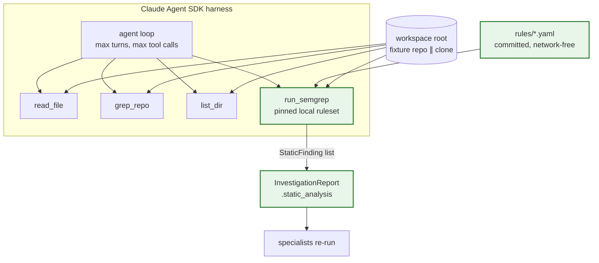

# ITER_04_v2 — Semgrep Investigator Tool and Demo (v2 MVP)

## §01 · Concept

> Unchanged — see SKELETON § 01

## §02 · Architecture

**Why this closes the weakest link.** The investigator's ITER_03 toolset is read-only exploration — `read_file`, `grep_repo`, `list_dir`. Its findings are only as good as what grep surfaces, which for a *security and licensing* gate is thin. Semgrep gives the harness an actual analysis capability, and it is added as a **tool inside the existing loop** rather than a new graph node: the architectural claim from ITER_03 § 02 — LangGraph sees one node, the Agent SDK owns the inner loop — is reinforced, not diluted.

**Data model — extensions only:**

- New entity **`StaticFinding`** — `rule_id`, `severity` (`info | warn | block`, reusing the `Finding` severity vocabulary so the UI badge component is shared), `path`, `line`, `message`
- `InvestigationReport` gains `static_analysis: list[StaticFinding]` (default `[]`) and `semgrep_runs: int` (default `0`) — additive with defaults, so `GATE_STATE_VERSION` stays at `2` for the same reason given in ITER_03_v2 § 02
- `StaticFinding` is persisted inside `InvestigationReport`, so it is **added to `CHECKPOINT_ALLOWLIST`** (ITER_01_v2 § 02). It is the last new entity in the v2 family; after this the allowlist is complete.

`Finding` is deliberately **not** given a `source` field. Semgrep output is evidence the investigator reports; a `Finding` remains a specialist's policy judgment citing a `policy_id`. Blurring the two would make "which policy does this violate" unanswerable for machine-generated hits.

**No routing, endpoint or graph-topology changes.** Reconcile's six rules (ITER_02 § 04) are untouched.

## §03 · Tech Stack

New this iteration:

- `semgrep` — pinned to an exact patch version. Rule behaviour changes between minors; an unpinned scanner makes the demo non-reproducible and every eval assertion flaky. **Check its Python support before pinning:** ITER_05 § 03 runs CI on 3.12 *and* 3.13, and semgrep has historically lagged new interpreter releases. If the chosen pin has no 3.13 wheel, it moves to an optional `[semgrep]` extra and the 3.13 CI leg runs without it — the degradation path (§ 04) already covers a missing binary, so this costs a matrix cell, not a feature.

> Everything else unchanged — see ITER_03_v2 § 03

## §04 · Backend

**`rules/` (new, committed):** a small pinned ruleset — a handful of registry rules vendored locally plus two or three hand-written rules aligned to the actual policy corpus (e.g. a rule matching new outbound network calls for `SEC-01`, a rule matching PII-shaped values reaching a logger for `DATA-03`). Rules that map to policy IDs are what make the investigator's output *citable* rather than generic lint noise.

**`run_semgrep` tool (`gate/agents/tools/semgrep.py`):**

- **Invocation:** fixed-argv `asyncio.create_subprocess_exec` — `semgrep --config <resolved rules dir> --json --quiet --metrics=off --disable-version-check --timeout <n> <path>`. The rules argument is the absolute path `paths.py` resolved (next bullet but one), never the literal `rules/` — a relative config path re-introduces the CWD assumption the asset resolver exists to kill. Never `shell=True`; the "no shell" invariant from ITER_03 § 04 holds because the argv is constructed entirely from config, not from model output.
- **Event-loop preflight (ITER_05 § 04, shared check per ITER_03_v2 § 04).** This is the third `create_subprocess_exec` call site after the Agent SDK and the workspace clone, and it fails the same way on a `SelectorEventLoop`: bare `NotImplementedError`, empty message. It calls the shared preflight and degrades to `semgrep unavailable: unsupported event loop` rather than surfacing nothing. `--reload` remains absent from every documented command.
- **`rules/` is a runtime asset.** It resolves through `paths.py` and must be added to hatchling's `force-include` map alongside `data/` and `static/` (ITER_05 § 03) — otherwise the installed wheel has an investigator whose scanner has no rules, which fails silently as "no static findings". `GATE_SEMGREP_RULES_DIR` overrides the resolved default.
- **The local `--config` is load-bearing, not incidental.** `--config auto` fetches rules from the network at run time, which breaks the harness's no-network sandbox *and* makes results non-deterministic between runs. The pinned, resolved local directory is the only permitted config.
- **The only model-controlled argument is `path`**, and it goes through the identical `Path.resolve()` + `is_relative_to(workspace_root)` check as the other three tools (ITER_03 § 04, root now injected per ITER_03_v2 § 04). A path outside the workspace returns a tool error, not an exception.
- **Budgets:** each run counts against `GATE_INVESTIGATOR_MAX_TOOL_CALLS` — semgrep is not exempt from the tool-call budget just because it is deterministic. Additionally `GATE_SEMGREP_TIMEOUT_S` (default 60), `GATE_SEMGREP_MAX_RESULTS` (default 50, results beyond it dropped with an explicit "N further results omitted" line), and `GATE_SEMGREP_MAX_RUNS` (default 2 per investigation, since re-running an unchanged tree is pure waste).
- **Failure containment:** non-zero exit, timeout, unparseable JSON, or a missing binary returns a tool result reading `semgrep unavailable: <reason>`. **A failed run still increments `semgrep_runs` and still spends a tool call** — otherwise a broken scanner is free to retry, and the agent, told the tool is available, will keep trying it until the turn budget dies instead of falling back to `read_file`. Consistent with ITER_03 § 04 — budget exhaustion and tool failure never raise into the graph.
- **Output shaping:** semgrep JSON is large and mostly metadata. The tool returns `rule_id`, `path`, `line`, `message` and severity only — feeding raw JSON into the agent's context would consume the turn budget on noise.
- Every run is a child span under the investigator span (ITER_02_v2 § 04) carrying `tool.name=run_semgrep`, rule count and duration.

**`agents/investigator.py` (updated):** registers the fourth tool and writes `static_analysis[]` + `semgrep_runs` into the returned `InvestigationReport`. The structured-output final turn (ITER_03 § 04) is unchanged in shape and, because the investigator tier carries an effort setting, goes through the `json_schema` path (ITER_05 § 06) — `static_analysis[]` is a nested model list, which is exactly the shape a forced tool call handles worst, so this is worth stating rather than inheriting silently.

**Specialist re-run context:** ITER_03 § 04 appends `investigation.summary` to specialist context on loop-back. That now also includes a compact rendering of `static_analysis[]` — `rule_id`, path and line — so a specialist can cite concrete evidence in a `Finding.description` and raise severity to `block` with something behind it. The `merge_findings` reducer (ITER_05 § 04) is what makes that raise visible: a re-run's batch *replaces* that specialist's prior findings, so the pre-semgrep `needs_more_context` finding does not linger next to the evidence-backed `block`. Under the original `operator.add` the panel would show both and reconcile would never drain the budget.

**Fixture upgrade:** `003_auth_change/repo/` gains a change that a committed rule actually fires on, so the fixture demo exercises the tool deterministically without depending on a live PR.

**New env vars:** `GATE_SEMGREP_TIMEOUT_S`, `GATE_SEMGREP_MAX_RESULTS`, `GATE_SEMGREP_MAX_RUNS`, `GATE_SEMGREP_RULES_DIR`.

**README demo script (rewritten this iteration — this is the portfolio artifact).** Setup is now two steps (`uv sync`, `.env`) plus an optional `docker compose -f docker-compose.langfuse.yml up -d`; the Chroma ingest step is gone (ITER_01_v2 § 04). The run command is `uv run uvicorn gate.api.app:app` — **no `--reload`**, which disables the investigator and now also the clone and semgrep (ITER_05 § 04). The installed-wheel path is documented alongside it, and it has no `.env.example` to point at (ITER_05 § 04), so it lists the required variables inline. Four beats:

1. **Fixture 001, docs typo** → auto-approved, zero Sonnet spend. Open the Langfuse trace: no Sonnet spans exist. *Cost gate #1, proven not asserted.*
2. **Fixture 002, dependency add** → license `block` → human gate → reject. *Policy citation against a deterministically-retrieved chunk.*
3. **Fixture 003, auth change** → specialist uncertainty → investigation → semgrep fires on a committed rule → human gate → request more info → re-investigation → approve. Trace shows tool calls, semgrep spans, cost estimate, and the loop budget draining. *Cost gate #2, shared human/machine cycle budget, failure-mode escalation.*
4. **A live public GitHub PR by URL** → MCP intake, workspace clone, full pipeline. *The gate works on real input, not just fixtures.*

Each beat names the mechanism it demonstrates, and each links a trace screenshot. Beat 4 is the one that could not exist in v1.

**Tests:** semgrep path-sandbox escape tests (reusing the ITER_03 sandbox cases against the new tool), a timeout test, a max-runs test, a max-results test asserting the "N further results omitted" line, an unparseable-output test asserting graceful degradation, an unsupported-event-loop test, and one `llm`-marked run of fixture 003 asserting `static_analysis` is non-empty and `semgrep_runs <= GATE_SEMGREP_MAX_RUNS`. Each failure mode is a branch under `fail_under = 100` (ITER_01_v2 § 04), so the degradation paths — including a missing `semgrep` binary — are unit-tested against a stubbed subprocess rather than covered by the `llm` run, which does not count. CI installs the pinned `semgrep` wherever the interpreter supports it (§ 03); a leg without it still runs the full unit suite, because every semgrep path is stubbed there.

## §05 · Frontend

- **Investigation panel gains a Static Analysis sub-panel:** `StaticFinding` rows grouped by `path`, showing `rule_id`, line and message, using the existing severity badge component (shared vocabulary is why `StaticFinding.severity` reuses the `Finding` enum). **The empty state keys off `semgrep_runs`, not off the list.** `static_analysis[]` defaults to `[]`, so an empty list alone cannot tell *ran and found nothing* from *never ran* — and that distinction is exactly what a reviewer needs, because one means the change is clean and the other means the evidence is missing. So: `semgrep_runs == 0` renders the `—` null placeholder, and `semgrep_runs > 0` with an empty list renders "no static findings". A failed run counts (§ 04), so it lands in the second case — the `semgrep unavailable` reason reaches the reviewer through the investigation summary the agent already writes, which avoids adding a field to `InvestigationReport` for a string that has a home.
- `semgrep_runs` and the existing `tool_calls_count` / `cost_estimate_usd` render together as the investigation's budget line.
- No new views, routes or polling behaviour.

> Otherwise unchanged — see ITER_03_v2 § 05

## §06 · LLM / Prompts

- **Investigator system prompt (revised):** the ITER_03 § 06 framing is kept ("answer only the open questions; use the fewest tool calls that settle them") and extended with tool guidance — run semgrep once early when a question concerns code behaviour rather than repository structure, then read only the files it flags; do not re-run it on an unchanged tree. Budgets are stated in the prompt *and* enforced by the harness; the prompt shapes behaviour, the harness guarantees it.
- **Context strategy:** semgrep results enter the loop shaped, not raw (§ 04), and are bounded by `GATE_SEMGREP_MAX_RESULTS`. No summarization pass — the caps are the strategy, as in ITER_03 § 04.
- **Evaluation:** fixture 003's `meta.json` gains `expected_semgrep_rule_ids[]`; the `llm`-marked test asserts at least one expected rule appears in `static_analysis`. Behavioural smoke, not a benchmark — deliberately the same standard set in ITER_03 § 06. `tests/system/eval_demo.py` (ITER_04 § 06, relocated per ITER_05 § 04) is extended to drive all four demo beats, with beat 4 `network`-marked and excluded from the default run so a green default suite never depends on GitHub being up. These evals are actually collected now — `python_files` includes `eval_*.py` (ITER_05 § 04) — so "the demo is presentable" is a claim a green `pytest -m llm` run can finally back.

---

## Out of MVP scope

- **mcp-cassette record/replay** — the natural next workstream now that ITER_03_v2 creates a real external-call surface worth recording; mocked JSON fixtures cover the gap in the interim
- **Prompt benchmarking beyond fixture smoke evals** — worth doing once live PRs supply a bigger, messier corpus
- Writing results back to GitHub (PR comments, check runs, labels) — the token is read-only by design
- Webhook / GitHub App triggered reviews; the gate is invoked, it does not listen
- Auth and multi-user on the web UI
- Hosted or containerized deployment *of the application* (the Langfuse compose file is a dev-time sidecar, not app deployment)
- ~~Packaging / registry distribution~~ — **shipped in v1** (ITER_05 § 03); the wheel exists and CI builds it. ITER_05 put PyPI *publication* on hold behind live GitHub intake, which this version delivers, so the hold is lifted: publication becomes a release decision (flip `publish.yml.disabled`), not a scope question. It is not a work item in this iteration.
- Pagination on list endpoints
- Multi-repo or org-wide policy sync; the policy corpus stays local and hand-authored
- Embedding-based policy retrieval — revisit only at the threshold documented in ITER_01_v2 § 02
