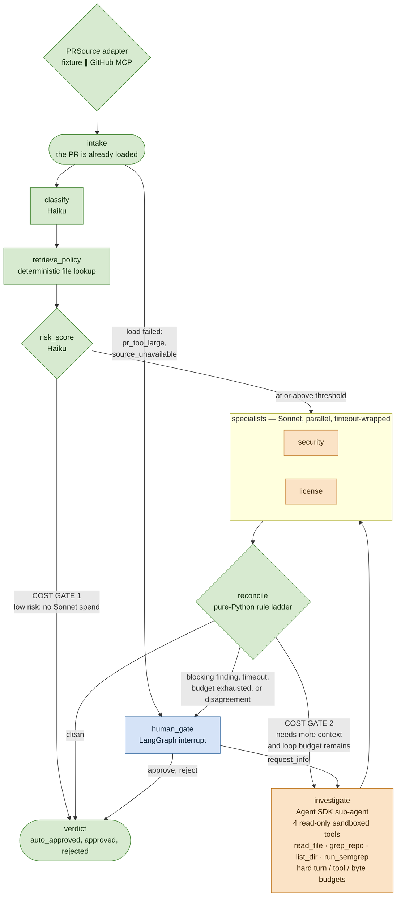

# PR Compliance Gate

A LangGraph + Claude Agent SDK pipeline that reviews pull requests against security, licensing,
and data-handling policy before merge — cost-gated, human-in-the-loop.

A Haiku classifier and risk scorer gate the pipeline: sub-threshold changes are auto-approved
without ever invoking a Sonnet specialist. Everything above the threshold fans out to parallel
security and license specialists, which can request a deeper autonomous investigation — an Agent
SDK sub-agent with four read-only sandboxed tools (including semgrep over a committed, pinned
ruleset) and hard turn/tool/byte budgets. Blocking or contested reviews stop at a human approval
gate. Every step is checkpointed to SQLite, so a review survives a process restart and resumes
where it stopped, and every run is traced end-to-end over OTLP.

Pull requests come from **live GitHub** by URL — metadata and the diff through the GitHub MCP
server, the repo tree through a shallow clone that becomes the investigator's sandbox — or from
local fixtures, which stay the deterministic substrate for the demo and the evals.

**Scope:** a portfolio artifact demonstrating production-grade agent orchestration — cost gating,
failure modes, human-in-the-loop, observability — not a hosted product. It is single-user with no
auth, and the token it uses is read-only: the gate never comments, labels or merges. Python 3.12+.

## Install

**Not published to PyPI.** The project is packaged and release-ready — the policy corpus, PR
fixtures, and UI are bundled into the wheel, so an installed copy runs without a checkout. The hold
that kept it unpublished (live GitHub intake, shipped in v0.2.0) is lifted, but publishing is a
separate decision this release has not taken; see the note at the end of this file. Install from a
checkout:

```bash
uv sync --extra dev                       # install, including dev tooling
uv run pre-commit install                 # ruff check + format on commit (once per clone)
cp .env.example .env                      # then set ANTHROPIC_API_KEY (+ GATE_GITHUB_TOKEN for live PRs)
uv run uvicorn gate.api.app:app           # serve the API + UI on http://127.0.0.1:8000
```

Two steps plus the server — policy retrieval is a deterministic `change_type` → file lookup
(`data/policies/index.yaml`), so there is no corpus to embed and no vector store to build.

Optional, for traces:

```bash
docker compose -f docker-compose.langfuse.yml up -d   # dev-time observability sidecar
uv sync --extra semgrep                               # the investigator's static-analysis tool
```

Both are optional by design. `GATE_OTEL_ENABLED=false` runs the gate with no trace backend at
all, and a missing `semgrep` binary degrades to `semgrep unavailable: …` inside the investigation
rather than failing the review — cloning this repo should not require Docker to see the gate work.

`uv build` produces a wheel that installs and runs the same way
(`python -m uvicorn gate.api.app:app`). An installed wheel has no `.env.example` to copy, so set
the required variables in the environment directly: `ANTHROPIC_API_KEY`, plus `GATE_GITHUB_TOKEN`
for live PRs. Everything else in the table below has a working default. The packaging is
exercised, just not published.

Either way, `checkpoints.db` and `data/workspaces/` are written into the current working
directory (override with `GATE_DB_PATH` / `GATE_WORKSPACE_DIR`). The app refuses to start against
a `checkpoints.db` written at a different `GATE_STATE_VERSION`; there is no migration for local
demo data, so delete the file and re-run.

Do not add `--reload` (or `--workers`). It makes uvicorn select a `SelectorEventLoop`, which
cannot spawn a subprocess — and three parts of the gate need one: the investigator drives the
Claude Code CLI, the workspace materializer shells out to `git`, and semgrep runs as a child
process. All three preflight the loop and name the cause instead of failing blankly.

The FastAPI app serves the UI same-origin — no CORS, no auth: a single-user local demo.

## Documentation

[`docs/guide/`](docs/guide/index.md) is the user and operator guide: getting started and the
review workflow for reviewers, and installation, configuration, monitoring, and an incident
runbook for operators.

## Pipeline



Green is the cheap path — Haiku, retrieval, and pure-Python routing. Orange is where real money is
spent: the Sonnet specialists and the Agent SDK investigator. The two gates exist to keep traffic
out of the orange band, and `reconcile` decides the route in plain Python, never with an LLM call.
Every node checkpoints to SQLite, so the human gate can hold a review across a restart.

The **intake short-circuit** is the one edge that exists purely to save money: when the adapter
could not load a PR at all — the diff is missing, so the outcome is already decided — the review
goes straight to a human instead of asking Haiku to classify nothing and Sonnet to review nothing.
It still runs *through* the graph, so a failed review is checkpointed, resumable and traced like
any other.

Every run is instrumented with OpenTelemetry and exported over OTLP to a self-hosted Langfuse.
That is what turns the cost claims above from assertions into evidence: filter traces on
`gate.risk.level=low` and there are no Sonnet spans. The detail view deep-links each review to its
trace.

## Demo script

Each beat names the failure-mode or cost feature it demonstrates. This arc is the artifact. Run
it headless (no UI, scripted human decisions, narrated stage-by-stage) with
`uv run python examples/demo.py` — each beat below maps to one section of its output.

1. **`001_docs_typo` — auto-approved, no Sonnet spend.** A README typo classifies as `docs`,
   scores below the risk threshold, and exits at `verdict(auto_approved)` straight from the
   Haiku scorer. Open the Langfuse trace: no Sonnet spans exist. **Cost gate #1, proven rather
   than asserted.**

2. **`002_new_dependency` — license block, human reject.** Adding a GPL-3.0 runtime dependency
   classifies as `dependency`, clears the risk gate into the specialists, and the license
   specialist raises a `block` finding citing `LIC-02` — against a chunk that was retrieved
   deterministically, not sampled by a top-k score. Reconcile routes to the human gate; the
   reviewer clicks **Reject**. Verdict: `rejected`.

3. **`003_auth_change` — investigation then human approve.** A session-validation refactor
   classifies as `code`. The security specialist cites `SEC-03` and sets `needs_more_context`
   (it cannot confirm the change is safe from the diff alone). Reconcile routes to
   **investigate** — the Claude Agent SDK sub-agent reads `src/acme/auth.py` and the logging
   config under hard turn/tool/byte budgets (tool-call count and cost estimate are visible in
   the UI). **Cost gate #2**: the investigator runs only because reconcile's rule 3 fired. The
   review reaches the human gate; the reviewer clicks **Request more info** (the note becomes an
   investigation lead), a re-investigation runs within the shared loop budget, and the reviewer
   then **Approves**. Verdict: `approved`. The trace shows the tool calls, the semgrep spans, the
   cost estimate, and the loop budget draining.

4. **A live public GitHub PR, by URL.** Paste a pull-request URL into the second input mode: the
   preflight resolves it through the GitHub MCP server (a bad URL is a `422` before a review row
   exists), the background task pages the changed-file list, fetches the diff, and shallow-clones
   the repo at `head_sha` into the investigator's sandbox. Then the same pipeline as beats 1–3.
   Headless equivalent: `uv run python examples/demo.py live --pr-url <URL>`, which needs
   `GATE_GITHUB_TOKEN` and is skipped without one. **The gate works on real input, not just
   fixtures** — this is the beat that could not exist in v1.

## Configuration

All configuration is env-driven (see `.env.example`). Notable knobs:

| Var | Meaning |
|---|---|
| `GATE_RISK_THRESHOLD` / high bound (75) | cost gate #1 boundary and the low/medium/high split |
| `GATE_MAX_CYCLES` | total investigations per review (machine + human `request_info` share it) |
| `GATE_SPECIALIST_TIMEOUT_S` | per-specialist timeout; on timeout the review escalates, never hangs |
| `GATE_INVESTIGATOR_MAX_TURNS` / `_MAX_TOOL_CALLS` / `_MAX_FILE_CHARS` | investigator hard budgets |
| `GATE_MODEL_*` | model per tier (Haiku for the cheap gate, Sonnet for specialists/investigator) |
| `GATE_MODEL_*_EFFORT` | reasoning effort (`low`…`max`) for that tier's model; never sent to Haiku |
| `GATE_POLICY_INDEX` | override for `data/policies/index.yaml`; validated at startup, never mid-review |
| `GATE_STATE_VERSION` | checkpoint schema generation; a mismatch refuses to start rather than crashing on resume |
| `GATE_OTEL_ENABLED` | kill switch — `false` installs a no-op tracer so the app runs with no backend |
| `OTEL_EXPORTER_OTLP_ENDPOINT` / `_HEADERS` | OTLP target and auth. **Unprefixed on purpose** — these are the OTel SDK's own names |
| `GATE_LANGFUSE_UI_BASE` | only used to build the UI's "View trace" deep-link |
| `GATE_GITHUB_TOKEN` | read-only PAT (`contents:read`, `pull_requests:read`). No write scopes, by design |
| `GATE_GH_MCP_COMMAND` / `GATE_GH_MAX_FILES` | the MCP server to launch, and the file count above which a PR escalates instead of being partly reviewed |
| `GATE_WORKSPACE_DIR` / `_MAX_GB` | clone cache location and LRU budget |
| `GATE_SEMGREP_TIMEOUT_S` / `_MAX_RESULTS` / `_MAX_RUNS` / `_RULES_DIR` | static-analysis budgets and ruleset |

Model ids in `.env.example` are env-overridable defaults — verify them against the live
Anthropic API before a real run.

## Tests

```bash
uv run pytest             # tests/unit + tests/integration — no API calls, no network
uv run pytest --cov       # same, with coverage; the gate is 100% of src/gate
uv run pytest -m llm      # tests/system: behavioral evals against the real API (needs a key)
uv run pytest -m network  # live GitHub smoke tests (needs GATE_GITHUB_TOKEN)
```

`unit` is pure logic, `integration` wires real components with the LLM/SDK/MCP boundaries stubbed,
and `system` holds the paid and live evals — both deliberately excluded from the coverage gate, so
neither spend nor GitHub's uptime is ever load-bearing for a green suite. GitHub intake is covered
by hand-captured JSON payloads replayed through the real adapter, and the clone is exercised
against a local bare repo; the default suite makes no network call at all.

## Out of MVP scope

- **mcp-cassette record/replay** — the natural next workstream now that there is a real
  external-call surface worth recording; hand-captured JSON fixtures cover the gap in the interim
- **Prompt benchmarking beyond fixture smoke evals** — worth doing once live PRs supply a bigger,
  messier corpus
- Writing results back to GitHub (PR comments, check runs, labels) — the token is read-only by
  design
- Webhook / GitHub App triggered reviews; the gate is invoked, it does not listen
- Auth and multi-user on the web UI
- Hosted or containerized deployment *of the application* (the Langfuse compose file is a
  dev-time sidecar, not app deployment)
- Pagination on list endpoints
- Multi-repo or org-wide policy sync; the policy corpus stays local and hand-authored
- Embedding-based policy retrieval — revisit only when a single `change_type` maps to more policy
  text than fits alongside the diff, or when policies within one category overlap enough that only
  semantic similarity separates them. Raw policy count is not the trigger; 2,000 policies cleanly
  partitioned by category are still a lookup problem

See `.agents_workspace/planning/v2`.

PyPI publication was held behind live GitHub intake, on the grounds that a package implying "worth
installing for real work" should not read pull requests from local fixtures. That intake shipped in
v0.2.0, so the hold is lifted: publication is a release decision (rename
`.github/workflows/publish.yml.disabled` back to `.yml`, and complete the one-time Trusted
Publishing setup its header describes), not a scope question. v0.2.0 did not take that decision —
GitHub only registers `.yml`/`.yaml` files, so no trigger in the workflow can fire meanwhile.

## License

Apache-2.0 — see [LICENSE](LICENSE).
