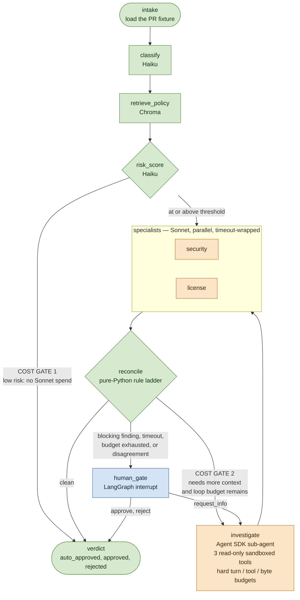

# PR Compliance Gate

A LangGraph + Claude Agent SDK pipeline that reviews pull requests against security, licensing,
and data-handling policy before merge — cost-gated, human-in-the-loop.

A Haiku classifier and risk scorer gate the pipeline: sub-threshold changes are auto-approved
without ever invoking a Sonnet specialist. Everything above the threshold fans out to parallel
security and license specialists, which can request a deeper autonomous investigation — an Agent
SDK sub-agent with three read-only sandboxed tools and hard turn/tool/byte budgets. Blocking or
contested reviews stop at a human approval gate. Every step is checkpointed to SQLite, so a
review survives a process restart and resumes where it stopped.

**Scope:** a portfolio artifact demonstrating production-grade agent orchestration — cost gating,
failure modes, human-in-the-loop — not a hosted product. It reads pull requests from local
fixtures rather than the live GitHub API, and is single-user with no auth. Python 3.12+.

## Install

**Not published to PyPI.** The project is packaged and release-ready — the policy corpus, PR
fixtures, and UI are bundled into the wheel, so an installed copy runs without a checkout — but it
stays unpublished until it is useful for productive work, which means live GitHub intake rather
than local fixtures. Until then, install from a checkout:

```bash
uv sync --extra dev                       # install, including dev tooling
uv run pre-commit install                 # ruff check + format on commit (once per clone)
cp .env.example .env                      # then set ANTHROPIC_API_KEY
uv run python -m gate.intake.ingest       # embed the policy corpus into Chroma (one-time)
uv run uvicorn gate.api.app:app           # serve the API + UI on http://127.0.0.1:8000
```

`uv build` produces a wheel that installs and runs the same way (`python -m gate.intake.ingest`,
`python -m uvicorn gate.api.app:app`) with `ANTHROPIC_API_KEY` set in the environment — the
packaging is exercised, just not published.

Either way, `checkpoints.db` and `.chroma/` are written into the current working directory
(override with `GATE_DB_PATH` / `GATE_CHROMA_DIR`).

Do not add `--reload` on Windows. It makes uvicorn select a `SelectorEventLoop`, which cannot
spawn a subprocess — and the investigator drives the Claude Code CLI as one, so it would fail on
every investigation.

The FastAPI app serves the UI same-origin — no CORS, no auth: a single-user local demo.

## Documentation

[`docs/guide/`](docs/guide/index.md) is the user and operator guide: getting started and the
review workflow for reviewers, and installation, configuration, monitoring, and an incident
runbook for operators.

## Pipeline



Green is the cheap path — Haiku, retrieval, and pure-Python routing. Orange is where real money is
spent: the Sonnet specialists and the Agent SDK investigator. The two gates exist to keep traffic
out of the orange band, and `reconcile` decides the route in plain Python, never with an LLM call.
Every node checkpoints to SQLite, so the human gate can hold a review across a restart.

## Demo script

Each beat names the failure-mode or cost feature it demonstrates. This arc is the artifact. Run
it headless (no UI, scripted human decisions, narrated stage-by-stage) with
`uv run python examples/demo.py` — each beat below maps to one section of its output.

1. **`001_docs_typo` — auto-approved, no Sonnet spend.** A README typo classifies as `docs`,
   scores below the risk threshold, and exits at `verdict(auto_approved)` straight from the
   Haiku scorer. **Cost gate #1**: a specialist is never invoked.

2. **`002_new_dependency` — license block, human reject.** Adding a GPL-3.0 runtime dependency
   classifies as `dependency`, clears the risk gate into the specialists, and the license
   specialist raises a `block` finding citing `LIC-02`. Reconcile routes to the human gate; the
   reviewer clicks **Reject**. Verdict: `rejected`.

3. **`003_auth_change` — investigation then human approve.** A session-validation refactor
   classifies as `code`. The security specialist cites `SEC-03` and sets `needs_more_context`
   (it cannot confirm the change is safe from the diff alone). Reconcile routes to
   **investigate** — the Claude Agent SDK sub-agent reads `src/acme/auth.py` and the logging
   config under hard turn/tool/byte budgets (tool-call count and cost estimate are visible in
   the UI). **Cost gate #2**: the investigator runs only because reconcile's rule 3 fired. The
   review reaches the human gate; the reviewer clicks **Request more info** (the note becomes an
   investigation lead), a re-investigation runs within the shared loop budget, and the reviewer
   then **Approves**. Verdict: `approved`.

## Configuration

All configuration is env-driven (see `.env.example`). Notable knobs:

| Var | Meaning |
|---|---|
| `GATE_RISK_THRESHOLD` / high bound (75) | cost gate #1 boundary and the low/medium/high split |
| `GATE_MAX_CYCLES` | total investigations per review (machine + human `request_info` share it) |
| `GATE_SPECIALIST_TIMEOUT_S` | per-specialist timeout; on timeout the review escalates, never hangs |
| `GATE_INVESTIGATOR_MAX_TURNS` / `_MAX_TOOL_CALLS` / `_MAX_FILE_CHARS` | investigator hard budgets |
| `GATE_MODEL_*` | model per tier (Haiku for the cheap gate, Sonnet for specialists/investigator) |
| `GATE_MODEL_*_EFFORT` | reasoning effort (`low`…`max`) for that tier's model; never sent to Haiku |

Model ids in `.env.example` are env-overridable defaults — verify them against the live
Anthropic API before a real run.

## Tests

```bash
uv run pytest            # tests/unit + tests/integration — no API calls
uv run pytest --cov      # same, with coverage; the gate is 100% of src/gate
uv run pytest -m llm     # tests/system: behavioral evals against the real API (needs a key + ingest)
```

`unit` is pure logic, `integration` wires real components with the LLM/SDK boundary stubbed, and
`system` holds the paid evals — which are deliberately excluded from the coverage gate.

## Out of MVP scope

Live GitHub intake, auth/multi-user, hosted deployment, tracing dashboards, pagination, real
static-analysis investigator tools. See `.agents_workspace/planning/v1`.

Publishing to PyPI is also deliberately on hold. The wheel is built, audited, and verified to run
standalone — but a package on PyPI implies it is worth installing for real work, and reading pull
requests from local fixtures is not that. Live GitHub intake is the gate: it lands first, then the
package ships. The release workflow is written and parked at
`.github/workflows/publish.yml.disabled`; GitHub only registers `.yml`/`.yaml` files, so no trigger
in it can fire until it is renamed back.

## License

Apache-2.0 — see [LICENSE](LICENSE).
